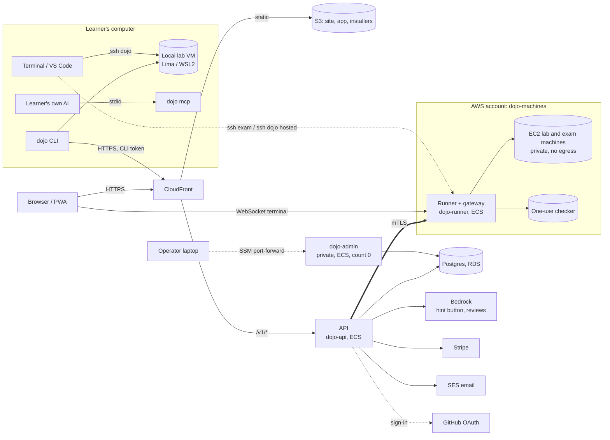
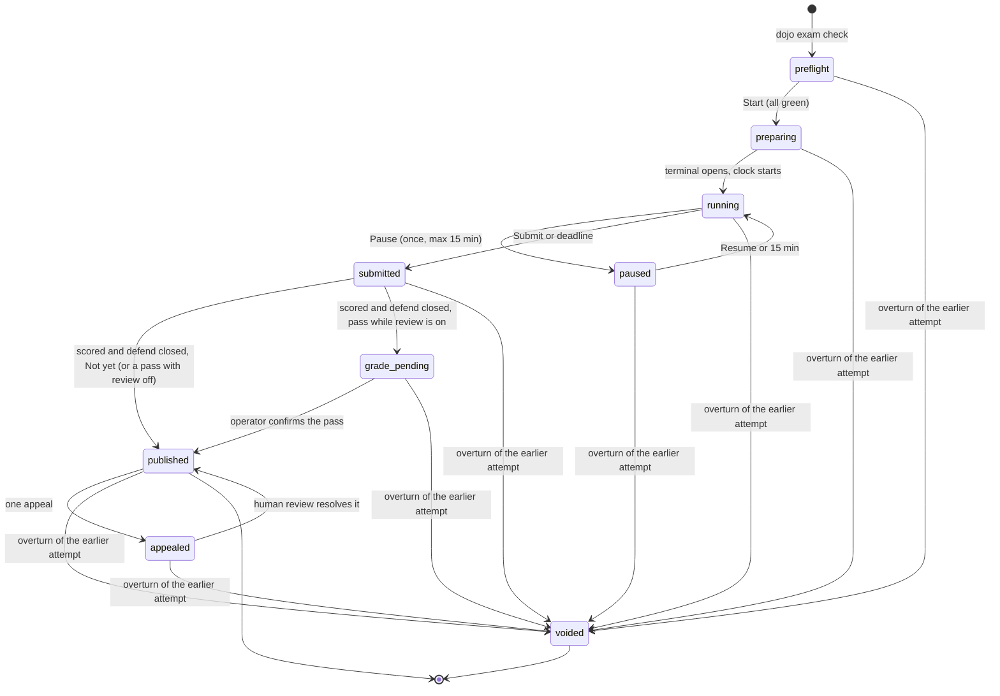

# Technical design: Dojo v1

Status: draft for review, rewritten 2026-11-20 for the paths, roles and work-day exam model.
It replaces the belt and kata design of 2026-11-19. Updated the same day with the project's answers to
the open questions (exam grading and appeals, onboarding, waitlist, share link, caps, domain,
accounts). Updated 2026-11-21 for the operator service (section 3.7, ADR 0002).

Sources of truth: the project brief of 2026-11-20, the design canvas v104 (its Map lists every
screen, codes below are the Map's) and the design ledger, both kept outside this repo. Where this document needs something none of them decides, it says
NEEDS-DECISION. Section 6 lists every place where the canvas and the brief disagree and says which
side wins; the canvas is fixed in a parallel round.

## 0. Scope and shape

Category: fast-money. Free to learn, with limits; money only where we pay for machines (Supporter
and hour packs). Done-line: a first learner finishes Foundations and Support L1 and passes the
Support L1 work-day exam on a hosted machine by 2027-03-31.

In v1 (from the brief): the `dojo` CLI with one verb set; local labs by default; hosted EC2
machines for the role exam and for laptops that cannot run labs, with a browser terminal; the web
(public pages, onboarding with "pick your path", Today, Path, ticket page with written hints and
the AI hint button, Practice, the role exam, "Ready for: Support L1", track record, emails, PWA);
Free, Supporter and hour packs through Stripe; usage analytics (EU, consent) and CLI telemetry
with opt-out.

Out of v1 (binding non-goals): Systems L2, Junior DevOps, SOC L1, Dev fundamentals, Backend,
Frontend (paths are drawn, not built); a Data path; chat with the AI on the site; peer review;
public portfolio and community pages; a Teams plan; per-learner ticket variants for practice; belt
marks beyond what Foundations and Support L1 need; any promise of a job or salary. Where a
non-goal touches a screen, this document designs at most a seam (a column or a flag) and says so.

The CLI and the local labs exist in this repo (`cmd/dojo`, `internal/lab`, `internal/kata`,
`internal/doctor`, `internal/sshconfig`, `internal/state`; the mentor files and `dojo mcp` are in
flight in PRs 6d and 6e). This document covers the CLI changes v1 needs and everything around it.



Pieces, one repo (public now; it will likely become one private monorepo, section 1.6):

| Piece | Where | What it does |
|---|---|---|
| Site | `web/` | Public pages (static Astro). |
| App | `app/` | The signed-in app: one React SPA, its own Vite build, served at `/app`. |
| API | `cmd/dojo-api`, `internal/server/...` | Sign-in, progress, hints, billing, exams, emails. Writes the database as `dojo_api`; operator writes go through the operator service (section 3.7). |
| Operator service | `cmd/dojo-admin`, `internal/admin/...` | Review queue, learner lookup, flags, every operator action audited. Private, never on the public origin (section 3.7, ADR 0002). |
| Runner | `cmd/dojo-runner`, `internal/runner/...` | Starts, pools, checks and destroys machines; SSH gateway; browser terminal. Runs in the machines account. |
| CLI | `cmd/dojo` (exists) | Labs, checks, hints, `dojo login`, `dojo exam`, `dojo mcp`. |
| Infra | `infra/` | OpenTofu for both accounts. |

## 1. Stack and services

### 1.1 Choices and why

Each row says why for this project. Nothing is here because another Kiban project uses it.

| Layer | Choice | Why this and not the alternative |
|---|---|---|
| API | Go, `net/http` routing, `pgx` + `sqlc`, `goose` | The CLI is Go, so the ticket format, the check protocol and the lab code are shared, not rewritten. `sqlc` keeps SQL visible and typed; the schema is relational and small, an ORM adds nothing. |
| Database | Postgres on RDS (`db.t4g.micro`, single AZ, daily backups, 30-day retention) | Constraints do real work here: one open exam per learner, unique usernames, a role pass needs a passed exam. RDS, not Aurora: Aurora is blocked on a Free-plan account and costs more than we need. One task fans live updates out with `LISTEN/NOTIFY`, so no cache or broker is needed. |
| Public pages | Astro, static output, Tailwind 4, shadcn/ui tokens | The distribution plan rests on search ("prácticas ASIR/SMR"), so public pages must be real HTML with no JavaScript needed to read them. |
| Signed-in app | One React SPA, its own Vite build in `app/` served by Caddy at `/app` with an index.html fallback (it shares only the design tokens with Astro, no mounting), React Router, TanStack Query, xterm.js | The app keeps state across screens: the command palette (K1), the inbox bell (N1), the live check mirror and the exam clock must survive navigation. Per-page islands would reload them on every move. No SEO is needed behind sign-in. |
| Live updates | Server-sent events (`GET /v1/stream`) from the API, `LISTEN/NOTIFY` between tasks | The web mirrors what the CLI reports (O3 "this page updates while you run it", L3 check results, H1 progress). One-way push is all that is needed; SSE passes CloudFront and the ALB without extra setup. Fallback: polling every 5 s. |
| Browser terminal | xterm.js, WebSocket to the runner, the runner opens SSH to the machine | Brief and design decision 2026-11-20. The runner holds the only route to the private machines. |
| Hosting, web and API | CloudFront in front of S3 (static) and an ALB (`/v1/*`, WebSocket); API on ECS Fargate (ARM) | All-in on AWS (decided 2026-11-20). Fargate: no host to patch. Not Lambda or App Runner: the API holds SSE and long-lived connections. One origin for site and API: no CORS, `SameSite` cookies just work, and the domain choice no longer constrains the design. The ALB accepts only CloudFront (managed prefix list plus a secret header). This choice does not depend on the parked one-shared-platform decision: everything here is Dojo's own account and is easy to move. |
| Region | `eu-south-2` (Spain) for both accounts, if Bedrock (and SES) are available there | Learners are in Spain; prices from the research (2026-11-19) match between the two regions for `t3.small`. Availability of the Bedrock model and SES in `eu-south-2` is not verified: M0b checks it. Fallback, decided now: Bedrock (and SES if needed) in `eu-west-1`, or the EU cross-region inference profile, with everything else staying in `eu-south-2`. |
| Hosted machines | EC2 `t3.small` from a Packer AMI, private subnet, no public IP, no egress, no instance profile, IMDS off, separate account | Per-machine isolation, per-second billing, security groups enforced outside the guest. Measured cost about EUR 0.025 per hosted hour. Fly Machines, E2B and Hetzner were compared and lost on systemd, egress control or checker access (ledger 2026-11-20). See ADR 0001. |
| Warm pool | A pool of running spare instances kept by the runner (1, 3, 10 at 100, 1,000, 10,000 active learners) | Cuts the 30 to 90 s start to a few seconds. About EUR 15 per spare instance per month; the pricing research says to cut it first if conversion stays low. Not the Auto Scaling warm pool: it keeps stopped instances and we do not use an Auto Scaling group. |
| Sign-in | GitHub OAuth App: web flow and device flow | Every learner needs GitHub anyway (repo, SSH key, signed commits). No passwords. |
| Payments | Stripe: Checkout, Customer Portal, webhooks | Chosen 2026-11-20. Monthly and yearly Supporter prices, one-off hour packs. Tax handling (Stripe Tax, a merchant of record or a gestor) and the GDPR review for 14 to 17 year olds are decided before the first charge (M8), not before building starts (section 7). |
| Email | Amazon SES over SMTP, from `carmen@` and `hello@` the domain | Same cloud, cents per thousand. SMTP gives one code path in production and in compose (Mailpit speaks it). Bounces and complaints come back through SNS to an API endpoint. Needs SES production access before launch. |
| Push | Web Push with VAPID keys sent by the API | No third-party push service. |
| AI hint button and reviews | Amazon Bedrock, a Haiku-class Claude model, called through an adapter | All-in on AWS (decided 2026-11-20), pays per token, and the provider does not train on inputs (verify in AWS service terms before launch). Cost estimate in the pricing research: about EUR 0.04 per learner a month. Exact model id and region verified in M7. |
| Web analytics | PostHog Cloud EU, loaded only after consent | Confirmed 2026-11-20: EU hosting, consent first. A signed-out visitor's choice lives in a first-party cookie and fills `learners.analytics_consent` at sign-in only while it is null; a choice already on the account wins. |
| CLI telemetry | Our own `POST /v1/telemetry`, a table in our database, kept 12 months | The CLI must not talk to a third party. Opt-out with `dojo telemetry off`; events carry command names, results and timings, never files or output. Anonymous events are accepted, rate limited per IP; authenticated ones per learner. The nightly job deletes rows older than 12 months (`prune_telemetry()`, section 3.3). |
| Infrastructure as code | OpenTofu in `infra/`, state in S3, GitHub OIDC for CI | Portable HCL with no long-lived AWS keys. |
| Domain and accounts | `dojo.kyoten.dev`, kept a config value (`PUBLIC_ORIGIN`); an AWS Organization with an app account and a machines account, created in M0b | Decided 2026-11-20. Dojo may get its own domain later, so no code, cookie name or email template hardcodes the host. `kyoten.dev` is not registered yet (ledger): NEEDS-DECISION to buy it; until then M0b runs on the CloudFront default domain. |
| Environments | `pre` from M0b, `pro` created only at launch | Halves fixed cost until there are learners (the research estimates about USD 55 to 60 per environment). `pre` and `pro` are separate stacks (VPC, database, ECS) in the app account; the machines account holds the machine networks of both. Names are `pre` and `pro`, never "prod". |

### 1.2 Engineering bars (from the first commit)

- **Supply chain (web):** pnpm, exact versions, `save-exact=true`, committed lockfile,
  `--frozen-lockfile` in CI, `pnpm audit` and OSV failing on high or critical, install scripts off,
  every dependency justified in its PR, an SBOM per release.
- **Layers (API):** handlers thin; logic in `internal/server/service/<domain>`; database access in
  `internal/server/repo`; every external system (GitHub, Stripe, SES, Bedrock, the runner,
  PostHog) behind an adapter with one interface.
- **Tenant column from day one:** every learner-owned row carries `org_id`. v1 has one org,
  `public`. Teams are parked; the column costs nothing and avoids a migration of every table.
- **Webhooks:** none leave us in v1. Inbound ones are verified: Stripe by its signature header, SNS
  by its signing certificate. If we ever send one it carries HMAC-SHA256.
- **Tests:** `test` is unit; `test:integration` runs against the real stack from
  `docker compose` (section 1.7), never mocks. Isolation is not testable on a container backend:
  an end-to-end exam on real EC2 with escape attempts (a planted symlink, a removed firewall rule,
  a job left running in a pause) is a gate before `pro`.
- **Workflows** follow the repo rules: one file per component and purpose (`Web: Tests`,
  `API: Tests`, `Infra: Plan`), Harden Runner, SHA-pinned actions, required checks never
  path-filtered (steps skip inside the job using our own `git diff`).

### 1.3 Hosted machines

The runner talks to a `Backend` interface (`Create`, `Assign`, `Exec`, `Stop`, `DetachDisk`,
`CheckDisk`, `Destroy`), the same idea as the local `lab.Backend`. Implementations: `ec2` and a
container backend for compose.

- **Network:** each machine has a private IP, a security group with no egress and ingress only
  from the runner's group, no instance profile, IMDS disabled, and a hard lifetime cap (the
  deadline plus one hour for exams, the session cap for labs) so a stuck machine cannot bill
  forever. Per-ticket egress allowlists are a seam, not built: v1 machines have no internet.
- **Control channel:** the runner SSHes in with its own key (public half baked into the AMI).
  There is no SSM and no instance role, so nothing on the machine can call AWS.
- **Assign:** a warm machine is taken from the pool, tagged to the learner, the ticket's
  `setup.sh` runs over SSH ("breaking the server on purpose", H1), and the learner's public key is
  authorized for that machine only. With an empty pool the runner launches a new instance (30 to
  90 s) and H1 says so.
- **Gateway:** the runner runs a small Go SSH server on a public endpoint. `dojo ssh` and
  `dojo exam` connect with the learner's own key, which is accepted only for that learner's open
  machine, then proxy to the private IP. The browser terminal does the same from a WebSocket to the
  runner (a `term.` hostname in `pre` and `pro`, the `/term` path on Caddy locally),
  authenticated by a one-minute ticket the API mints from the session. The CLI writes an
  `ssh exam` and `ssh dojo` host entry as it does today. Public endpoint type (NLB or a single
  Elastic IP on a Fargate task) is chosen in M5b on cost.
- **Metering:** a `hosted_sessions` row opens when the terminal first opens and closes when the
  machine ends. Free hosted lab sessions are capped at 90 minutes and stop after 15 minutes idle
  (decided 2026-11-20). The role exam is never metered: it does not draw on hosted hours, on any
  plan, and its session is recorded as `counted_as = exam` for cost tracking only.
- **Supporter hosted hours (fair use).** Supporter lab hours are not unlimited: a soft cap of
  60 hours a month (about 2 hours a day) after which the app asks for an hour pack (pricing research wording), and a hard stop at 100 hours a month (numbers from the
  pricing research). Both live in `system_flags` (`supporter_soft_cap_h`, `supporter_hard_cap_h`)
  and are served with the quota by `/v1/me`, so `dojo status --quota` and E4 read them from
  `hosted_sessions` totals without a second source. The exam is never counted against them.
- **Machine ceilings.** `system_flags.max_concurrent_machines` caps every running machine, and
  `system_flags.max_free_lab_machines` caps the share free learners can hold (the free-pool
  ceiling). When a ceiling is hit, a new lab start is queued, not refused: H1 and `dojo start`
  say "All hosted machines are busy. You are number N in line; we will start yours as soon as one
  frees up." Exam machines are never queued behind labs: each exam slot is reserved outside the
  free-lab ceiling, so an exam that passed preflight never loses its slot.
- **Abuse limits.** Sign-in and machine starts are rate-limited by IP (and by learner on starts)
  at the API, so farmed accounts cannot drain the free pool. The exam has its own spend alarm: an
  AWS Budget on the machines account at EUR 100 a month for exam machines, emailing us at 80 and
  100 percent.
- **Exam checks run outside the guest** (ADR 0001): stop the machine gracefully, force it off
  after 30 seconds, attach its root volume to a one-use checker with no network (the runner reads
  results over the checker's SSH, which needs no outbound), mount read-only with `noload,nodev,
  nosuid,noexec`, and run the checks against that tree. File content is treated as hostile data:
  no symlink follows out of the mount (`openat2` with `RESOLVE_IN_ROOT`), nothing from the disk is
  executed. A crafted filesystem attacks the checker's kernel and could in principle forge its
  output; v1 accepts that for a step on our own path rather than a third-party credential, and the
  checker is destroyed after every use. Whether to read with userspace tools instead of a kernel
  mount is decided in the M6b spike. Consequence for content: Support L1 exam tickets are written
  as file-state checks (configs, enabled units, permissions, rotation rules).

### 1.4 AI hint button and reviews

One adapter, one endpoint family, two uses.

- **Hint (`POST /v1/hints/ai`, also `dojo hint`):** needs an active ticket id. The server loads the
  ticket brief and the written hints the learner already opened, plus the last check output (cut at
  16 KB), and calls Bedrock. It sends nothing else. Rules, all server side, none in the prompt:
  3 per ticket on Free and 10 on Supporter; each hint is unlocked by a failed check since the
  previous one; each one is more specific than the last and never the command; a hint is refused on
  an exam machine and in role exams; input capped at 6,000 tokens and output at 400; one request
  per 20 seconds. The reply is checked before it is shown: any code block, or a match against the
  ticket's `hint_guard` patterns (derived from the private solution and kept in the API-only
  `catalog_secrets` table, section 3.3; the CLI never has them), rejects it and the learner gets the next written hint instead.
- **Spend control (decided 2026-11-20):** every call records its tokens in `ai_hints`. A hidden
  daily cap of 20 AI hints per learner (never shown in the UI; hitting it reads as "no more hints
  today, try the written hints, back tomorrow") and a monthly Bedrock spend cap of EUR 50. The
  app estimates spend from recorded tokens and, at the cap, writes the current month to
  `system_flags.ai_cap_month` through `trip_ai_cap()` (section 3.7). AI hints are off while
  `ai_enabled` is false (the operator's switch) or `ai_cap_month` is the current month, so the cap
  lifts by itself when the month turns; an AWS Budget alarm at 80 percent and 100 percent of EUR 50 emails us and is the backstop
  if the estimate drifts. When AI is off, the button on L3 is disabled with the text "AI hints are
  paused for now. The written hints still work", `dojo hint` says the same, nothing is charged
  to the learner, and writing-task and exam rubric reviews keep their own reserve: the reserve is
  a separate flag (`ai_reviews_enabled`) that only the operator turns off, so a hint spike can
  never block an exam grade.
- **Review (writing tasks, story tone, simulated feedback rounds):** the same adapter returns a
  rubric review as strict JSON (a list of named boolean criteria with a quoted line as evidence).
  Feedback only: it never decides a role. The exam is the exception, section 2.7, where the same
  booleans feed the pass rule and a person checks each pass while volume is low.
- **Privacy:** terminal output of learners aged 14 to 17 goes to a processor. Legal review is open
  (section 7).

### 1.5 Environments, delivery, operations

| Environment | What | How |
|---|---|---|
| local | The whole product, `docker compose up` (section 1.7) | Docker and Docker Compose only |
| `pre` | Real GitHub OAuth app, Stripe test mode, SES sandbox, real Bedrock, a small machine pool of its own | Deploy on merge to `main` |
| `pro` | Same shape in its own stack in the app account, real Stripe, warm pool sized to the active learners | Deploy on a release tag, created at launch |

- API and runner are container images on ECR (pushed over GitHub OIDC); migrations run as a
  one-off ECS task before each deploy; the site and app are synced to S3 and invalidated.
- Logs are JSON to CloudWatch with a request id that the 500 page (X2) shows. Metrics and alarms:
  request errors, machines running, exam start latency and failure rate (alarm over 2%, a kill
  trigger in the pricing research), hosted spend against revenue, Bedrock spend, SES bounces.
- Maintenance (X3) is a `system_flags` value the API serves; the CLI keeps working on local labs
  and queues events.
- Backups: RDS daily, 30 days. The privacy page says deleted accounts leave backups within 30 days.

### 1.6 Distribution, and the switch to a private repo

The repo is public now and will likely become one private monorepo (CLI, web, API). Nothing may
depend on its being public:

- The installer (`curl -fsSL <domain>/install | sh`) and the binaries are served from our own S3
  and CloudFront (`/dl/<version>/dojo-<os>-<arch>` plus a checksum manifest signed with a key the
  script knows). The release workflow builds with GoReleaser and uploads over OIDC; GitHub Releases
  is not used. There is no Homebrew tap in v1.
- The API tells the CLI the minimum version it supports (`min_cli_version`); `dojo doctor` and
  `dojo exam check` report an outdated CLI.
- Ticket bundles (`ticket.yaml`, `setup.sh`, `check.sh`, no solutions) are built from the private
  catalog repo (`kibanbuild/dojo-katas`) into S3 and fetched by `dojo start` through the API, with
  a `catalog_version`. A ticket can be fixed without a CLI release. Solutions, wrong-fix tests,
  the exam pool and exam checks stay in the private repo and on the runner, never in a bundle.
  The hint guard patterns travel the other way: the deploy job reads them from the private catalog
  repo and writes them to `catalog_secrets` (API-only, section 3.3) in the same step that loads
  `catalog_items`; they are not in S3 and no endpoint serves them.
- **`check.sh` ships.** It is in every bundle and on hosted labs, so a practice ticket's expected
  end state is readable by the learner and by their AI. That is an accepted limit of practice,
  which is self-reported anyway (section 3.2). Exams never ship checks.
- **Going private.** On the free GitHub org plan, private repos lose rulesets and get capped
  Actions minutes. The move to a private monorepo therefore goes together with GitHub Team.
- "Report a broken ticket" and "I'm stuck: get help" post to our API (section 3.3,
  `ticket_reports`) instead of opening a GitHub issue, so they keep working when the repo closes.
- The learner's own practice repo (`<login>/dojo`) is theirs and unaffected.

### 1.7 Local stack

Every piece must run locally with Docker and Docker Compose, and one `docker compose up` brings up
the whole product. The AWS deployment stays the target, but nothing is built against AWS first:
every milestone is built and tested on the local stack, and deploying to `pre` is a separate step.
Each external service sits behind an adapter (section 1.2); production and local differ only in
configuration and the adapter implementation chosen, never in the code that calls it.

| Piece | Production | Local stand-in | Not covered locally |
|---|---|---|---|
| Edge (site, `/v1/*`, WebSocket) | CloudFront, S3, ALB | Caddy in front of the web build and the API on `http://localhost:8080`, same single origin and path routing | CDN caching, TLS, the ALB-only-from-CloudFront rule |
| Web and app | S3 static | Vite dev server for `make dev`, or the built static files served by Caddy | none |
| API | ECS Fargate | The same container image | Fargate limits |
| Operator service | ECS Fargate in a private subnet, desired count 0, reached by SSM port-forward | The same image as a compose service published only on `127.0.0.1:8090`, not behind Caddy, with its own fake-GitHub OAuth client | SSM, IAM and MFA, scaling to 0 |
| Database | RDS Postgres | Postgres in a container, same major version, migrations run by a one-off service | RDS backups, failover |
| Installer, binaries, ticket bundles | S3 over CloudFront | MinIO (S3 API, so the same adapter and presigned URLs) | CloudFront signing |
| Email (E1 to E8) | SES over SMTP | Mailpit (SMTP in, web inbox to read) | Deliverability, DKIM, SNS bounce delivery (tests post a signed bounce payload to the endpoint) |
| Payments | Stripe | `stripe-mock` (Stripe's own mock API) for Checkout and Portal calls. Webhooks are sent by a small test helper that signs them with a local signing secret, so the handler verifies signatures exactly as in production. The Stripe CLI forwarder is not used: it needs a Stripe account and the network | Real Stripe behaviour, Tax, 3-D Secure |
| AI hints and reviews | Bedrock | The same adapter pointed at a deterministic stand-in (fixed replies keyed on the ticket and the hint number, used by every test). An optional compose profile points it at Ollama with a small local model to try real wording | Real model quality, quotas, Bedrock spend |
| Web analytics | PostHog Cloud EU | A browser-side analytics adapter (PostHog runs in the browser) whose local sink logs each event to the browser console, so nothing leaves the machine | PostHog itself |
| CLI telemetry | Our endpoint | The same endpoint and table | none |
| Sign-in | GitHub OAuth App (web flow, device flow, check-token and revoke endpoints) | A small fake GitHub in the repo that implements those endpoints (a generic OIDC stand-in such as dex does not implement GitHub's device flow or token check). The API reads the GitHub base URL from config. Device flow is enabled per client (`FAKE_GITHUB_DEVICE_CLIENTS`, default the web client); tests approve a code with `POST /login/device` (`user_code`, `login`, `decision`) | GitHub's real consent screen, rate limits |
| Hosted machines | EC2 in the machines account | The runner with a container backend: each machine is a systemd-capable container on an internal Docker network with no route out, started through the Docker socket (a development-only privilege, never in `pre` or `pro`). The warm pool, assignment, SSH gateway, browser-terminal WebSocket, pause and metering all run. The check flow is scoped to "exercises the same runner code path": a container rootfs is not a detachable volume, so the local machine keeps the state to be checked on a named Docker volume (not its rootfs), and the checker is a second container that mounts that volume read-only. systemd inside Docker Desktop is fragile; the M6b spike proves the local design (or the claim stays at this scope) | Real isolation (security groups, IMDS, no instance role), EBS detach and attach, kernel-mount attacks, real start times. The EC2 exam with escape attempts is the gate for this |
| API-to-runner mTLS | Private CA certificates, client cert on the API, server cert on the runner | The same mTLS code path: a one-off compose service generates a throwaway CA and the two certificates into a shared volume at start; the API and runner load them like in `pre` | Real certificate issuance and rotation |
| Machine image | Packer AMI | A Dockerfile per image | Packer |
| Push | Browser vendors' endpoints | A local push endpoint stub | Real delivery |
| Infrastructure | OpenTofu | none | All of it, checked by `Infra: Plan` in CI |

- One `compose.yaml` starts all of it; profiles keep the heavy parts optional (the Ollama model,
  the browser end-to-end tests). `make dev` is `docker compose up` plus the web dev server.
- Secrets in local are fixed test values in `.env.example`. The public origin is a config value
  (`PUBLIC_ORIGIN`), `http://localhost:8080` locally (`http://localhost:4321` under `make dev`, via `compose.dev.yaml`).
- `test:integration` runs against this stack and never mocks a service we have a stand-in for. The
  fake GitHub and the deterministic AI stand-in are ours; each gets one smoke test against the
  real service in `pre`.

## 2. App flow

### 2.1 Where the learner moves

```
public (P1-P4, P6, LG1) -> O0 pick path -> O1 sign in -> O2 install -> O3 doctor -> O4 key+repo
  -> O5 first ticket -> Today (L1) <-> Path (R1) <-> Practice (R6)
Today -> Ticket (L3) -> writing task (L9) / quiz (L11) / story moment (L4) -> next ticket
Path -> all tickets of the role done -> L6 rules + preflight -> H1 preparing -> R3/H2 work day
  -> submit -> defend (feedback) -> result (a pass waits for a person first): R4 role passed -> R5 record
     or L6 not yet -> practise -> retry (an appeal is possible once, after the result)
```

The app nav is Today, Path, Practice, plus the inbox bell (N1), the command palette (K1, desktop)
and the avatar menu (Settings S1-S4). Exam screens drop the nav for the on-call header: role, four
parts as a status strip, "no hints, no AI", the shift clock, Pause and Leave.

A signed-out visit to an app route redirects to sign-in and returns. A signed-in learner with no
role progress lands on O0 (no path) or the first unfinished onboarding step.

### 2.2 Screens

Routes are a proposal; the Map's codes are the contract. "State" lists the first-run, empty and
error cases the page must draw. Status is the Map's.

| Code | Route | Primary action | States |
|---|---|---|---|
| P1 Home | `/` | Pick your path (to O0); copyable install command | Static. |
| P2 How it works | `/how-it-works` | Start Support L1 (to O0) | Static. Ends with the FAQ as a section of this page (no page of its own). |
| P3 Paths and roles | `/paths` | Pick your path | Static. Four paths drawn; only Systems and DevOps is open, the others say "coming soon" (section 2.3). |
| P4 The story | `/story` | Pick your path | Static. |
| P6 Pricing | `/pricing` | Become a supporter (to sign-in, then Stripe Checkout); Buy hours | Monthly and yearly toggle. Signed-in learners see their own plan. Teams: "Contact us" mailto only. |
| LG1 Privacy, terms, conduct | `/privacy`, `/terms`, `/conduct` | none | Names the hint button, usage stats and what survives account deletion. Legal text written and reviewed before launch (NEEDS-DECISION for the reviewer). |
| O0 Pick your path | `/start` | Continue: stores the chosen path in a short-lived cookie, applied at first sign-in | Reachable signed out. Security, Backend and Frontend show "coming soon" with "Tell me when" (the waitlist, section 2.3). |
| O1 Sign in | `/app/signin` (in the SPA) | Continue with GitHub (web flow, section 3.1) | Asks for age (14 or older) and terms on first sign-in. Error: GitHub refused or the state check failed, retry. |
| O2 Install | `/start/install` | Copy the install command per OS (Windows with WSL, macOS, Linux), then `dojo login` | Waits for `login` via SSE ("Waiting for dojo login on your computer"). Shows the usage-stats notice and `dojo telemetry off`. Error: code expired, show a new one. |
| O3 Doctor | `/start/doctor` | Continue (enabled when every line is green) | Waiting, 2 to fix, all good, blocked. Blocked: "Use a hosted lab" turns on `learners.hosted_default` and goes on. "I'm stuck: get help" opens the report form. |
| O4 SSH key and repo | `/start/key` | Continue when the checklist is green | Steps the learner follows, each with the command to copy; `dojo doctor` verifies them and the page turns each line green (section 2.4). Failing lines show the fix. |
| O5 First ticket | `/start/first` | Copy `dojo start support-l1/terminal-01` | Updates when the lab is ready, then when the ticket passes (a signed commit). |
| L1 Today | `/today` | Continue the ticket / Start the next one | First run (after O5): "day one done", next ticket, role progress. Empty never occurs after onboarding. Maintenance and offline show a banner. |
| R1 Your path | `/path` | Start or continue the role; Test out of Support L1 | Systems L2 and Junior DevOps show as locked "coming later" with no test-out card. Foundations passed; belt on the side. |
| L3 Ticket | `/t/*id` (for example `/t/support-l1/perms-03`) | Copy `dojo start <id>`; Show hint; Ask Carmen (AI hint) | States below. |
| L9 Writing task | `/t/*id` (kind `writing`) | Ask for review; Save draft | Draft saved as you type; review shows criteria and one fix. Passes when submitted (feedback only). |
| L11 Quiz | `/quiz/:id` | Check answer, Next | Never blocks. Done screen offers the missed question again. |
| L4 Story moment | `/story/:id` | Choose a reply | Tone review; Today shows the next moment. In v1. |
| R6 Practice | `/practice` | Copy `dojo start <slug>` | Filter chips; a scenario you have passed shows "passed". Never blocks the path. |
| N1 Inbox | bell dropdown, `/inbox` on phone | Open the item | Empty: "Nothing new". Mark all read. |
| K1 Command palette | `Cmd+K`, everywhere in the app on desktop | Run the highlighted action | Continue ticket, next hint, copy `dojo check`, search tickets and lessons. No docs search in v1. |
| L6 Exam rules and preflight | `/exam/:role` | Start the exam | Rules; preflight checklist (CLI version, SSH reachable, no other lab, three free hours); disabled reason shown for each unmet rule (section 2.7). Leave says what happens to the clock and the work. |
| H1 Preparing your machine | `/exam/:role/machine`, also shown for hosted labs | none (waits) | Four steps with real progress from the runner, CLI mirror. Error: no capacity or start failed, retry; the clock has not started. |
| R3/H2 The work day | `/exam/:role/day` | Submit the exam (after a confirm step) | Queue of four parts, answer boxes that autosave ("Saved 10:42"), browser terminal or `dojo exam`. Clock states: extra time applied, paused, warnings, clock hidden (section 2.7). Phone: "open this on a computer", the clock has not started. |
| L6 Defend | `/exam/:role/defend` | Send answers | Three questions, 30 minutes, draft saved, skip allowed. Feedback only, never scored. |
| L6 Submitted, checking a pass | `/exam/:role/result` | none (waits) | Canvas v109 L6 Submitted. While scoring and defend run it says "Submitted. Checking your work."; once defend closes, a Not yet goes straight to L6 Not yet, and a pass waiting for review shows "Submitted. Checking your pass." (telling the learner it scored as a pass before E2 is deliberate: the wait already says so). Shows the submitted time and the one-appeal rule. `dojo status` shows the same. |
| L6 Not yet / R4 Role passed | `/exam/:role/result`, `/roles/:role/passed` | Practise (not yet); See your track record (passed); Appeal | Not yet shows the five scored items, what did not hold and one retry date. Appeal is offered once per attempt, with a reason box (canvas v104 L6 Appeal and L6 Appeal decided, section 2.7). |
| R5 Track record | `/record` | Share (opt-in switch, copy link, regenerate or revoke) | Empty before the first role. Private by default; the learner turns sharing on and chooses which practice items show. Foundations and Support L1 entries read "Verified by Dojo" only when the pass is server-side (exam); tickets and practice read "Practice". |
| Public record | `/r/:token` | none | Only when the learner opted in; the token is long, random and unguessable, and the learner can revoke it or regenerate it (the old link then dies). Shows verified work and the items they chose, nothing else, `noindex`, not listed. There is no per-name record URL and no username namespace. This is not a public portfolio. |
| L7 / L8 Belt mark, belt | `/celebrate/:id` | Next ticket | Shown once, then in the inbox. L8 only when the four white marks are done. |
| A1 Review queue | `dojo-admin` `/review` (never on the public origin) | Confirm a pass; Override a part with a note; Resolve an appeal | Operator only, served by the operator service (section 3.7); canvas v108 A1 (desktop only). Section 2.7. |
| A2 Learner lookup | `dojo-admin` `/learners` | Give hours or Supporter, take a gift back; void an attempt; suspend; delete (GDPR) | Operator only, section 3.7; canvas v108 A2 and the delete confirm (desktop only). |
| A3 System switches | `dojo-admin` `/flags` | Change a flag (confirm and reason) | Operator only, section 3.7; canvas v108 A3 and the switch confirm (desktop only). |
| Accessibility statement | `/accessibility` | none | New, from the a11y review; linked from the footer. |
| S1 Account | `/settings/account` | Save; Switch path; Test out; Delete account | Username and language of explanations save through `PATCH /v1/me` (section 3.1); the rest of the list is path, plan, hour packs, extra time, usage stats, danger zone. |
| S2 Machines | `/settings/machines` | Revoke a CLI token | Lists CLI devices (OS, version, last seen; `GET /v1/me/devices`) and the SSH key (a later milestone); revoking calls `DELETE /v1/me/devices/{id}` (3.1). |
| S3 Notifications | `/settings/notifications` | Toggle | Per-kind push and email; quiet 22:00 to 08:00 local. No streak emails ever. |
| S4 Your AI | `/settings/ai` | Copy MCP config; Test the connection | Per-tool tabs. |
| E1-E8 | emails | see 2.9 | |
| W1-W5 | PWA | see 2.10 | |
| X1-X3 | `/404`, `/500`, `/maintenance` | Go to Today; Try again | 500 shows the request id. |

**Ticket page (L3) states:** starting (progress while the lab boots), in progress, lab did not
start (for example not enough disk: offers `dojo doctor` and a hosted lab), lab expired (after
7 days without a dojo command, work is in the repo, run `dojo start` again), failed check (last
output mirrored), passed (time, hints, the commit), revisit (a passed ticket; all written hints
open; `dojo start <id>` again restarts the same ticket, with no new variant and no change to
progress).

### 2.3 Paths in v1

O0 shows the four paths. v1 builds only Systems and DevOps: Foundations and Support L1, with
Systems L2 and Junior DevOps drawn as locked "coming later". Security, Backend and Frontend are
"coming soon": picking one does not start anything. The learner can leave their email address on
file (their sign-in email) with "Tell me when", which adds a row to `path_waitlist`; signed out,
the choice is kept in the cookie and the row is written after sign-in. A learner who wants to
start meanwhile picks Systems and DevOps, whose Foundations every path shares. The waitlist counts
are the signal for which path to build next.

### 2.4 First run (O0 to O5), with the CLI

1. **O0:** pick a path.
2. **O1:** sign in with GitHub, confirm age 14 or older and the terms. First sign-in creates the
   learner and sends E1.
3. **O2:** `curl ... | sh` installs the CLI, `dojo login` runs the device flow. The page turns
   green when the API sees the login.
4. **O3:** `dojo doctor` checks memory, disk, git, git identity and a VM manager (Lima, or WSL2 on
   Windows), prints a fix line per problem, and reports each result to the page. A laptop that
   cannot run labs sets the hosted lab default and skips to O4.
5. **O4:** the learner follows the steps on the page: create an SSH key, add it to GitHub for
   signing, turn on commit signing (`gpg.format ssh`), create the practice repo `<login>/dojo`
   and a ruleset on `main`, and turn on 2FA and secret scanning. Every step shows the command or
   the GitHub link to copy. We never receive write access to their GitHub, which keeps O1's
   promise ("no access to your code"). `dojo doctor` verifies each step from the laptop (the key
   exists and is on the account, signing is configured, the repo exists and is public, the
   ruleset is on, AGENTS.md is present) and reports the result, so the page turns green line by
   line. There is no `dojo setup git` command. The `ssh dojo` host entry is written by
   `dojo start`.
6. **O5:** `dojo start support-l1/terminal-01` boots the first lab; `dojo check` passes it as a
   signed commit; Today opens.

### 2.5 CLI commands

One verb set for tickets, practice and exams. Labs run on the laptop by default; a hosted machine
only for the role exam and for laptops that cannot run labs.

| Command | What it does | States and errors |
|---|---|---|
| `dojo doctor` | Checks the computer can run labs and, for O4, the SSH key, signing, practice repo and ruleset; a fix to copy per problem; reports results to the API when logged in. | Offline works, results queue. Outdated CLI is reported. |
| `dojo login` | GitHub device flow (section 3.1), stores the CLI token in the OS keychain or `DOJO_HOME` (file `token`, 0600; the keychain is a later card). `--force` logs in again. Address, GitHub host and client id come from flags or `DOJO_API_URL`, `DOJO_GITHUB_URL`, `DOJO_GITHUB_CLIENT_ID`; the API address and client id have no built-in default until the domain exists. | Code expired (`expired_token` or `token_expired`): retry. Denied on GitHub: retry. No account yet: sign up on the website first. Already logged in: says who. |
| `dojo logout` | `DELETE /v1/auth/cli`, then deletes the token file (also on `401`, the token was already dead). | API unreachable: the file stays, the command fails and points to `--local`, which only forgets the token on this computer. |
| `dojo start <id>` | Fetches the ticket bundle (a ticket already started or passed restarts the same ticket, `--again` is not a variant), starts the lab (or a hosted machine when the laptop cannot, `--hosted` to force it), runs the ticket's `setup.sh`, writes `AGENTS.md` and `CLAUDE.md` (`@AGENTS.md`) into the lab and repo (PR 6d), reports `ticket.started`. | Not enough disk or memory: says how much and offers a hosted lab. Offline: starts from a cached bundle if present, else says it needs the network once. Out of hosted hours: on Free, names the pack and Supporter options; a Supporter at the 100 h hard stop is told the fair-use limit is reached and the date it resets. |
| `dojo ssh` | Opens a root shell on the lab (local, or through the gateway for a hosted one). | No lab running: says `dojo start <id>`. |
| `dojo check` | Reboots the lab so only persistent fixes pass, runs the checks, keeps the last output (PR 6d), reports pass or fail and the output, and on a pass writes a signed commit into the practice repo. | `--quick` skips the reboot. Offline: result saved and sent later. |
| `dojo stop` | Stops the lab, frees memory. Hosted: ends the machine and the session. | Work stays in the repo. |
| `dojo status` | What is running and the current ticket id; `--quota` shows hosted hours (E4). | Nothing running: says so. |
| `dojo exam` | `check` runs preflight; bare `exam` connects to the hosted exam machine over SSH; `submit` ends the exam. | Refuses with the missing rule (section 2.7). No AI, no hints on this machine. |
| `dojo hint` | The AI hint for the current ticket (section 1.4). Written hints stay on the web. | Needs a failed check; shows hints left; offline or capped says so. |
| `dojo mcp` | MCP server over stdio for the learner's own AI: current ticket, last check, hints opened, docs links; never a solution (PR 6e, hand-rolled JSON-RPC). | Does not run while an exam is open (a courtesy). |
| `dojo telemetry [on\|off\|status]` | Local switch for CLI usage stats (file `telemetry.json` in `DOJO_HOME`; on by default); mirrored to the account's `usage_stats` through `PATCH /v1/me` when logged in. `off` also drops the queue. The first command prints the notice on stderr ("Dojo shares usage stats ... When you are logged in they are tied to your account ... Turn it off any time with: dojo telemetry off") and neither it nor any earlier command sends; sending starts with the next one. The dispatcher records the command name, a result (`ok`, `failed`, `error`, `canceled`) and `duration_ms`, never arguments; `mcp` and `telemetry` are not recorded. Events queue in `telemetry-queue.json` (0600, atomic writes, at most 100) and flush in batches of at most 20 within 2 s at the end of a command: `204` or `400` drop the batch, `429` and other failures keep it and hold sending (Retry-After or one minute, at most an hour), a `401` on the bearer drops the batch and holds sending, never resending it anonymously (the account may have usage stats off) and never logging the learner out. `DOJO_TELEMETRY=off` or `DO_NOT_TRACK=1` always wins, and the environment can only turn it off. At `dojo login` (and when already logged in) the CLI reads `usage_stats` from `/v1/me`: an account that is off turns the local switch off. | API unreachable on `off`: the local switch stays off and the command says the account setting was not changed. |

The CLI today has `list`, `hint` (written), `shell`, `clean` and `ssh-config`; v1 renames `shell`
to `ssh`, `clean` to `stop`, drops `list` (the web lists tickets), repoints `hint`, folds
`ssh-config` into `start` and `doctor`, and adds `login`, `exam`, `mcp`, `telemetry`. Each is its
own small PR.

### 2.6 Hints

- **Written hints** (three per ticket, in the catalog): shown on the web only after the learner
  opens them (`hint.opened` event). Hint 3 needs hint 2. It is a nudge, not a lock: they ship in
  the bundle, which is fine for practice.
- **AI hint:** the button on L3 ("Ask Carmen") opens after a failed check and works as in 1.4,
  with the same limits from `dojo hint`. It shows hints left and the answer in place. No chat.
- Hints are counted for the learner, never gate anything.

### 2.7 Role exam: the work day

One rule, for this document and the canvas. The work day has **four parts**: a ticket from Javi
(the printer), a vague brief from Lucía, an incident, and a handoff. It is scored on **five
items**: (1) the fixes, checked on the machine, (2) the ticket reply, (3) the response to the brief
(the questions asked), (4) the incident update, (5) the handoff. Pass is **4 of 5**. Three hours,
one pause of up to 15 minutes, extra time 1.5x if the learner turned it on, retry 7 days after the
result is published. No hints, man pages and docs allowed. The learner's own AI is never allowed
during the exam, and neither is ours.



- **What is written where.** The fixes happen on the machine. The reply, the questions on the
  brief, the incident update and the handoff are written in answer boxes on the page and autosave
  to `exam_artifacts` ("Saved 10:42"); the page shows the autosave state.
- **Who can start.** The API refuses unless the learner passed every ticket of the role (or is
  testing out of Support L1), has no open attempt (open = preflight, preparing, running, paused, submitted or grade_pending; published, appealed and voided are not open), and `retry_after` and any tombstone for their
  GitHub id are past. L6 names which rule is missing. **Test out** (Support L1 only) skips the
  "passed every ticket" rule and nothing else: `POST /v1/exams/support-l1/attempts` with
  `{"test_out": true}` (stored as `exam_attempts.test_out`), the same preflight, the same exam,
  the same 4 of 5 pass rule. The API ignores the flag for any other role. Support L1 is free on every plan. Roles
  marked `advanced` need Supporter (a seam for later roles, nothing in v1).
- **Clock on the server.** `deadline = started_at + 3h x time_factor`; resume moves it by the time
  actually paused. A sweeper (one task at a time, Postgres advisory lock) runs every 15 seconds:
  it resumes pauses past 15 minutes, never ends a paused exam, submits at the deadline and sets
  `defend_closed_at` once defend has been open 30 minutes.
  Whatever is autosaved at the deadline is what is graded, and the page says so.
- **Exam screen states** (all components of the on-call header): extra time applied ("Extra time
  on, 4:30"), running, paused with "Pause used" and a Resume button, warnings at 30, 10 and 5
  minutes as a text banner (never colour or sound alone), expired (autosaved answers submitted),
  clock hidden on request (the warnings stay), saved or saving, a submit confirmation that lists
  the parts done and not started, and a Leave dialog that says what happens to the clock and the
  work (the clock keeps running; leaving does not pause it). Pause is one control with one name.
- **Pause** kills open SSH sessions and forwards, refuses new ones and stops the clock. A job left
  running is accepted: checks read the final state.
- **Access.** Preparing uses a warm machine when one exists. Exams are free and equal on every
  plan: no plan is served first. The clock starts when the terminal opens. The learner reaches the machine through the gateway with
  their own key, or the browser terminal.
- **Scoring.** On submit the machine is checked on the checker (section 1.3), item 1 passing only
  if every fix holds. Items 2 to 5 are scored by the Bedrock reviewer, which returns booleans
  against a fixed rubric per item with a quoted line as evidence; an item passes when its required
  booleans are true, computed by code, not by the model. The reviewer reads the learner's free
  text, so prompt injection could try to flip the booleans; the operator check on every pass (below)
  covers it. `pass_review_required` is not switched off until a prompt-injection eval set
  passes against the rubric reviewer. The result so far is stored as
  `provisional_result`. The learner sees a one-line `learner_summary` per item and never check
  output or the rubric.
- **Pass review (while volume is low).** Decided 2026-11-21: only a pass waits for a person.
  Prompt injection only helps a learner pass, so a scored Not yet is published as soon as scoring
  ends (E3 at once) and the learner can still appeal it. A scored pass sits in `grade_pending` and
  appears in the review queue (A1 in the operator service, section 3.7): oldest first, showing the
  learner's answers, each rubric boolean with its evidence, the machine results and the learner
  summary. The operator confirms, or overrides an item with a note; the override is recorded and
  wins, so a pass can become a Not yet. Publishing sets `result`, `retry_after` (publication plus
  7 days) and `published_at`, writes the role pass on a pass and sends E2 or E3. The requirement is
  a flag (`system_flags.pass_review_required`) so it can be switched off when volume justifies it;
  with it off, a pass is published automatically too. While a pass waits the learner sees
  "Submitted. Checking your pass." on L6 and in `dojo status`, and gets no result email until
  publication. The target turnaround shown to the learner is NEEDS-DECISION (the canvas says
  "usually within one working day").
- **Appeal.** After publication the learner can appeal once per attempt, with a short reason, within
  7 days. A person reads the answers and the grade, and either upholds it or overturns an item;
  an overturn can turn a not yet into a pass (then the role pass is written, `retry_after` is
  cleared and a corrected E2 is sent); an overturn also voids any open second attempt, so the
  learner never holds a pass and a live retry together: an open, published or appealed second attempt moves to `voided`, its result (if any) is dropped, and its machine, if still running, is destroyed through `teardown_jobs`. The appeal does not pause the retry wait. The decision and
  who made it are stored in `exam_appeals`. Appeals appear in the same review queue.
- **Defend.** After submit the learner answers three "why" questions written from a text diff of
  their changes against the broken baseline (read, never run), within 30 minutes, skippable. It is
  feedback only and is never scored. It runs while scoring finishes, and publication waits until
  defend closes (answered, skipped or 30 minutes), so a Not yet never lands in the middle of it. It stays in v1.
- **One retry date.** `retry_after` is the only date, set at publication; L6 Not yet, E3 and
  `dojo status` all show it.
- **After scoring:** the machine and the checker are destroyed; the root volume is kept as
  evidence until the appeal window ends (7 days after publication), then deleted.
- **Delete during an exam:** it counts as a `not_yet` for the retry wait (the tombstone), queues
  the teardown, and the attempt row is deleted with the rest.

### 2.8 Hosted lab (a laptop that cannot run labs)

`learners.hosted_default` (set from O3 or `--hosted`) makes `dojo start` ask the API for a hosted
machine. The same H1 progress screen appears in the web and the CLI; the ticket page shows the
browser terminal next to the ticket ("hosted machine, no internet"); `dojo ssh` works through the
gateway; `dojo check` runs `check.sh` on the machine over SSH and the result is self-reported like
a local one. Free is 10 hours a month; at 80 percent and at 100 percent the learner gets E4 and
sees "Buy 10 hours" and "Become a supporter". Packs are used last, after the monthly allowance.
Sessions stop at the 90 minute cap or after 15 minutes idle. Supporters have fair use: a soft cap
of 60 hours a month and a hard stop at 100 (section 1.3). When the machine ceilings are hit,
starts wait in a queue with a clear message (section 1.3). The role exam machine is never drawn
from these hours. On a phone there is no terminal.

### 2.9 Billing and emails

- **Supporter:** Checkout (EUR 9 a month or EUR 90 a year, founding price kept for life by staying
  on the founding Stripe price while subscribed), then E5. Cancel in the Customer Portal; E6 says
  what stays. Packs are one-off Checkout sessions (10 h for EUR 3, 25 h for EUR 6, valid 12 months).
  Webhooks are idempotent by Stripe event id and are the only writer of billing tables.
- **Emails:** E1 welcome (names the path), E2 role passed, E3 not yet, E4 hours low, E5 supporter
  welcome, E6 supporter ends, E7 weekly summary (Sundays), E8 account deleted (the last email,
  sent once). Product news is off by default. No streak or "you have not practised" email.
  Every email is queued in `email_outbox` (section 3.3), whose `(kind, ref)` key makes it go once;
  bounces suppress an address.

### 2.10 Phone and offline

W1 install sheet, W2 notification ask, W3 push content, W4 offline page, W5 Today on the phone. The
service worker caches the app shell, the current ticket and its opened written hints. Writes made
offline are not queued by the web; the CLI keeps working against the local lab and queues its own
events. The exam and the browser terminal are desktop only.

### 2.11 System states

Maintenance (X3): the site shows it, local labs keep working, `dojo check` saves and syncs later.
500 (X2): request id shown. 404 (X1). Signed-in pages show a banner when the API is unreachable.

## 3. Data and auth

### 3.1 Sign-in

- **Web:** OAuth authorization-code flow run by the API (`/v1/auth/github/start` and
  `/callback`), with PKCE and a `state` bound to the browser by a short-lived cookie. Scopes:
  `read:user user:email` (the email is needed for E1 to E8; GitHub emails can be private, and
  `/user/emails` needs `user:email`). The callback upserts the learner by numeric `github_id`,
  revokes the GitHub token it received (`DELETE /applications/{client_id}/token`, never
  `.../grant`), and sets the session cookie `dojo_session`: a random 256-bit id stored hashed,
  `HttpOnly`, `SameSite=Lax`, 30-day sliding expiry, and `Secure` whenever `PUBLIC_ORIGIN` is
  `https` (Safari drops `Secure` cookies on `http://localhost`, so the local stack goes without).
  In `pre` and `pro` the API refuses to start unless `PUBLIC_ORIGIN` is `https`, so a wrong origin
  can never ship cookies without `Secure`. The environment is the required `DOJO_ENV` variable
  (`local`, `pre` or `pro`). The cookie value is 32 random bytes in unpadded base64url (43
  characters); the API stores and looks up the sha256 of that string, and a value of any other
  length never reaches the database. The sliding expiry is written at most once a minute per session.
  GitHub may return no usable email; `learners.email` is then empty until the learner adds one.
- **Sign-out:** `POST /v1/auth/logout` (no body, `Content-Type: application/json` and `X-Dojo-Csrf`)
  needs a cookie session that the session middleware resolved; it sets `revoked_at` on that session,
  clears `dojo_session` with the attributes it was set with and answers `204`. No cookie principal
  (anonymous, an unknown or already revoked cookie, or a bearer call) is `401`; a missing CSRF header
  is `403`. A suspended learner can still sign out. A bearer call is not a cookie session: it gets `401`
  here and signs out through `DELETE /v1/auth/cli` (below).
- **Age and terms:** O1 asks for both before "Continue with GitHub". `start` takes them in a
  POST body (never query parameters, so a link from elsewhere cannot tick them) and carries them in
  the short-lived state cookie, which is signed by the API and bound to the OAuth `state`, as O0
  carries the path. The callback records `age_confirmed_at`, `terms_accepted_at` and `terms_version`
  from the server's own clock and the required `TERMS_VERSION` config (the API refuses to start
  without a valid one; `unrecorded` is reserved); the cookie only says the boxes were ticked.
  They are needed only to create a learner:
  when an unknown GitHub account comes back without them (for example from a sign-in started on
  P6), the callback stores nothing and sends the browser back to O1 to confirm. So no GitHub data
  is kept before the 14-or-older confirmation, and no session exists for a half-created account.
  A returning learner signs in without ticking them again.
- **Rate limit:** every `/v1/auth/*` route, and anonymous `POST /v1/telemetry` (60 a minute), is limited per
  client IP; authenticated `POST /v1/telemetry` is limited per learner (120 a minute, shared by the learner's devices), so one valid token is not unlimited. The general per-learner limit for the other authenticated writes is a separate piece (issue 83). The client IP is the address `TRUSTED_PROXY_HOPS` entries from the right of
  `X-Forwarded-For` (1 locally, behind Caddy; 2 in AWS, behind CloudFront and the ALB), or the
  connection address when the header is shorter; the header is never trusted further.
- **CLI login:** `dojo login` uses the GitHub device flow with our client id (the same OAuth App as
  the web flow, device flow enabled), asking for the scopes `read:user user:email`, and sends the
  resulting token once to `POST /v1/auth/cli`. Rate limited with the rest of `/v1/auth/*`.
  - Request: JSON body (`Content-Type: application/json`, at most 4 KB) with `access_token` (the GitHub
    token, 1 to 255 of `A-Za-z0-9_-`), `device_name` (1 to 64 characters, no control or invisible format
    characters, no leading or trailing space), `os` (1 to 32 of `A-Za-z0-9._/+ -`, for example `darwin/arm64`) and
    `cli_version` (1 to 32 of `A-Za-z0-9._+-`). Unknown fields are ignored. The route reads no cookie
    and no `Authorization` header, so a stale token on the CLI never blocks a new login.
  - The API calls GitHub's check-token endpoint (`POST /applications/{client_id}/token`, basic auth
    with our client id and secret) and accepts only a `200` whose `app.client_id` is ours: another
    app's token, an unknown or a revoked one is refused. It reads the user id and login from that
    answer, the verified primary email from `GET /user/emails` when the grant includes `user:email`
    (a grant without it logs in with no email), and then revokes the GitHub token
    (`DELETE /applications/{client_id}/token`, a `404` counts as already gone, two retries). If the
    revoke fails the login fails and is retried from the device flow: no GitHub token is ever stored
    or logged. The revoke happens for every outcome after a successful check, including the refusals
    below.
  - Only an **existing learner** gets a CLI token. Age and terms are confirmed only on O1, so the CLI
    never creates a learner: an unknown GitHub account is `403 signup_required` and `dojo login` tells
    the person to sign up on the website first. A suspended learner is `403 account_suspended`. A known
    learner's `github_login` and `email` are refreshed as in the web flow (a non-empty GitHub email
    replaces the stored one, an empty one keeps it).
  - Response `201` with `{"token": "dojo_<43 characters>"}`, `Cache-Control: no-store`. The token is
    `dojo_` plus 32 random bytes in unpadded base64url (48 characters in all); the prefix tells a
    secret scanner and a person it is ours and never a session cookie. Only its sha256 is stored,
    with the device name, OS and CLI version. It has no expiry: it lives until revoked, and
    `last_used_at` (written at most once a minute) is what S2 shows as "last seen".
  - Errors, all `{"error": "<code>"}`: `400 bad_request` (not JSON, wrong content type, a field out of
    its limits), `401 github_rejected` (GitHub does not know the token as ours: expired, revoked,
    another app's, already used for a login), `403 signup_required`, `403 account_suspended`,
    `429 rate_limited` (with `Retry-After`), `502 github_unavailable` (GitHub failed, including a
    revoke that kept failing; retry the whole login), `500 server_error`.
- **CLI requests:** `Authorization: Bearer dojo_...`. The API checks the shape, then the sha256 in
  `cli_tokens`; a revoked token does not resolve (`401 unauthenticated`); a suspended learner's
  token resolves but gets `403 account_suspended` on routes that need an active learner, like
  `/v1/me`. A non-empty `Authorization` header that is not a valid, active CLI token is `401` on
  every route, never an anonymous request. A request has one credential: with an `Authorization`
  header the bearer decides and any session cookie is ignored (bearer wins), so a call is never both
  CSRF-exempt and cookie-authenticated. A bearer is not a cookie session either: the web sign-out
  refuses it.
- **CLI sign-out:** `DELETE /v1/auth/cli` with the bearer token revokes that token (`dojo logout`)
  and answers `204`; no bearer principal is `401`; a suspended learner can still do it. Revoking
  another device's token by id is S2, below.
- **Devices (S2):** both routes need an active learner and take the cookie or the bearer (a cookie
  `DELETE` needs the CSRF headers). Errors are `{"error": "<code>"}`: `401 unauthenticated`,
  `403 account_suspended` (list only), `403 csrf_rejected`, `500 server_error`.
  - `GET /v1/me/devices` answers `200 {"devices": [...]}`: the learner's non-revoked CLI tokens,
    most recently used first, each `{id, device_name, os, cli_version, created_at, last_used_at,
    current}`. `id` is the `cli_tokens` row id (never the token or its hash); `current` is `true`
    only on the token the request itself carries, so it is always `false` for a cookie call. An
    empty list is `[]`.
  - `DELETE /v1/me/devices/{id}` revokes that token and answers `204`, only if it is the caller's
    and not yet revoked. An unknown, another learner's, already revoked or malformed id (anything
    but the canonical 8-4-4-4-12 form, hex digits in either case; no dashes, underscores or braces) is the same `404 not_found`, so the route is no oracle for
    other learners' token ids. Revoking the token the call carries is allowed (it is a sign-out):
    the next call with it is `401`. A suspended learner cannot list (`403 account_suspended`) but can
    still revoke their own tokens (self-service, scoped by `learner_id`, like `DELETE /v1/auth/cli`
    and web sign-out); another learner's id stays `404`.
- **No token to the learner's GitHub.** Their practice repo is public and is read without auth.
- **CSRF:** every state-changing request authenticated by the session cookie needs a JSON body and
  a custom header (`X-Dojo-Csrf`, any non-empty value, with `Content-Type: application/json`;
  refused with 403 `csrf_rejected`); the site and the API share one origin, so no CORS is allowed. CLI requests carry
  their token in the `Authorization` header, which a browser never adds by itself, so they are
  exempt. A request is authenticated by one credential only: one with a bearer token ignores any
  session cookie, so the exemption never covers a cookie-authenticated request.
- **Untrusted CLI input:** event payloads are limited (64 KB per event, 1 MB per batch, check
  output 16 KB) and always rendered escaped.
- **Username:** unique, lowercased, 3 to 30 characters `[a-z0-9-]`, reserved list; defaults
  to the GitHub login when free. Only shown to the learner and used in the app; it carries no
  public URL, so a change needs no redirect.
- **Profile update (S1):** `PATCH /v1/me`, for an active learner by cookie (with the CSRF header and a
  JSON content type) or bearer. Body `{"username"?, "language"?, "usage_stats"?}` (`usage_stats` a JSON boolean, the usage-stats switch the CLI mirrors), at least one, and any other field is
  refused (`400 bad_request`, as is a non-JSON, empty, oversized or trailing body; a `null` counts as
  absent). `username` is lowercased, then held to the sign-in rules (`^[a-z0-9-]{3,30}$`, not reserved),
  so `Ada-New` saves as `ada-new`; `language` is `en` or `es`, exactly; a non-boolean `usage_stats` is `400 bad_request`. Answers `200` with the body of
  `GET /v1/me`, and sets `updated_at`. Errors, all `{"error": "<code>"}`: `400 invalid_username`,
  `400 invalid_language`, `400 bad_request`, `401 unauthenticated`, `403 csrf_rejected`,
  `403 account_suspended`, `409 username_taken` (the unique index decides, so two racing renames
  cannot both win), `500 server_error`. Re-sending the current values is a `200`. It writes only the
  columns `dojo_api` may update (3.3). There is no availability-check route in M1: it would let a
  signed-in learner enumerate usernames for little gain, and S1 shows the `409` at save instead.
- **Age:** a self-declared confirmation of 14 or older at first sign-in. No other check.
- **Exam SSH access:** the learner's public key is registered for one machine; no lookup by GitHub
  username, so a renamed login cannot be authorised by mistake.
- **Operators:** listed in the `operators` table, which only the operator service can read or
  write. Every operator screen and action lives in the private operator service (section 3.7);
  the public API has no operator routes and the public app no operator screens. Every action
  records who made it and why.

### 3.2 Who is trusted with what

Local checks run on the learner's machine, so a ticket pass is self-reported. That is fine:
tickets are practice. Only the role exam is authoritative, and it runs on our machines.

| Event | Source | Trusted for |
|---|---|---|
| Onboarding steps, doctor results | CLI | Showing progress only |
| Ticket started, check run (pass or fail and output), written hint opened | CLI, web | Today, path, role progress |
| Hosted lab check | CLI over the gateway | Same as local: self-reported |
| Quiz answers | Web | Quizzes |
| Writing task, story reply, reviews | Web and Bedrock | Feedback only |
| Exam items and result | Machine checks on the runner, the rubric reviewer, and the operator's confirmation of a pass | Role passes, track record "Verified" |
| Stripe events | Stripe (signed) | Plans and hours |

The CLI sends events to `POST /v1/events` (batched, idempotent by a client-generated id) after each
command; offline it queues them in `DOJO_HOME`. The API stores them, updates `ticket_progress`, and
pushes the change to any open page over SSE ("mirrored from your laptop" is the last check and lab
state the CLI reported, not a live stream).

### 3.3 Tables

Every table also has `org_id`, `created_at`, `updated_at`. Ids are UUIDv7. `learner_id` references
`learners(id)` and cascades on delete unless noted. Columns arrive with the milestone that first
reads or writes them (M1 creates `learners` with the sign-in, settings and consent columns only);
each migration states the grants for `dojo_api` and `dojo_admin` (section 3.7).

| Table | Key columns | Notes |
|---|---|---|
| `orgs` | `slug`, `name` | One row, `public`. |
| `learners` | `github_id` (unique), `github_login`, `username` (unique), `email`, `language` (en, es: explanations), `extra_time`, `hosted_default`, `age_confirmed_at`, `terms_accepted_at`, `terms_version`, `usage_stats` (bool), `analytics_consent` (null, true, false), `chosen_path_id`, `record_shared` (default false), `record_token_hash` (null when not shared), `suspended_at` | `extra_time` applies to every exam. `terms_version` is the API's required `TERMS_VERSION` at creation (1 to 32 of `a-z 0-9 . -`), insert-only like `terms_accepted_at`; rows from before the column read `unrecorded`. `record_shared` is the opt-in for the share link; the token is shown once, stored hashed, and regenerating replaces the hash. |
| `sessions`, `cli_tokens` | `learner_id`, `token_hash`, `last_used_at`, `revoked_at`; tokens add `device_name`, `os`, `cli_version`, `ssh_public_key` | Hashes only. M1 creates `cli_tokens` without `ssh_public_key` (the exam milestone adds it). `dojo_api` reads, inserts the device row and updates `last_used_at`, `revoked_at` and `updated_at`; no `DELETE`, and `dojo_admin` has no grant. No expiry: a token ends when revoked or when the learner is deleted (cascade). |
| `paths`, `roles`, `path_roles` | `slug`, `title`, `status` (available, planned); roles add `kind` (foundations, role), `has_exam`, `advanced`; join has `position` | Content, loaded at deploy. v1 data: one available path. |
| `catalog_items` | `id` (for example `support-l1/perms-03`), `role_id` (null for practice), `kind` (ticket, writing, quiz, story, feedback, practice), `position`, `title`, `est_minutes`, `tags`, `awards_mark`, `catalog_version`, `bundle_key` | Loaded from the catalog at deploy; the API never parses YAML per request. |
| `ticket_progress` | `learner_id`, `item_id`, `state` (started, passed), `lab` (local, hosted), `check_count`, `written_hints_opened` (int array), `last_check_at`, `last_check_pass`, `last_check_total`, `last_check_output`, `first_passed_at`, `passed_seconds`, `passed_commit` | One row per learner and item. Revisits never change `first_passed_at`. |
| `events` | `learner_id`, `client_id` (unique per learner), `type`, `payload` (jsonb), `at` | Append-only audit behind `ticket_progress`. |
| `quiz_answers`, `writing_drafts`, `story_choices` | learner, item, answers or `body`, `review` (jsonb), `submitted_at` | Feedback records. |
| `belt_marks`, `belt_awards` | mark `slug`, `belt`, `title`; award `learner_id`, `mark_id`, `source_ref`, `awarded_at` | Maturity, from writing, simulated feedback rounds and exam artifacts. The white belt has four marks; none unlocks or blocks a role. The fourth, a feedback round, is a simulated one: Carmen or a team lead sends feedback in a `feedback` item (drawn like a story moment, L4) and the learner replies, reviewed by rubric. No peer is involved. |
| `exam_defs`, `exam_items` | def: role, `version`, `duration_s` (10800), `pause_s` (900), `pass_items` (4), `parts` (the four parts); item `code` (fixes, reply, brief, update, handoff), `kind` (machine, rubric), `part`, `title`, `rubric` | Content. The five items are data. |
| `exam_attempts` | `learner_id`, `role_id`, `def_version`, `state` (preflight, preparing, running, paused, submitted, grade_pending, published, appealed, voided), `test_out`, `started_at`, `deadline`, `paused_at`, `pause_used`, `time_factor`, `machine_id`, `submitted_at`, `defend_closed_at` (set by the API when defend is answered or skipped, or by the sweeper at 30 minutes), `provisional_result`, `grade_status` (pending, published), `result` (passed, not_yet, null), `items_passed`, `published_at`, `retry_after`; `grade_status` defaults to `pending`, the publication columns to null | Partial unique index: one open attempt per learner (`state IN (preflight, preparing, running, paused, submitted, grade_pending)`), so an appeal or a voided row never blocks a retry. `result` is set once at publication; the only later changes are an overturn through `exam_appeals` and voiding (an overturn of the learner's earlier attempt), both enforced by a trigger. Unique `(id, learner_id, role_id, result)`. |
| `exam_item_results` | `attempt_id`, `item_code`, `passed`, `rubric_result` (jsonb: booleans and evidence), `learner_summary`, `internal_output`, `override_passed` (null unless overridden), `overridden_by`, `override_note` | `internal_output` and `rubric_result` are for us; the learner sees `learner_summary`. An override wins over the scored value. |
| `exam_artifacts` | `attempt_id`, `item_code`, `body`, `saved_at` | The learner's replies, questions, update and handoff. |
| `exam_appeals` | `attempt_id` (unique: one per attempt), `reason`, `state` (open, upheld, overturned), `resolved_by`, `resolution_note`, `resolved_at` | A person decides. |
| `exam_defence` | `attempt_id`, `question`, `answer`, `review` | Three rows; feedback only, never scored. |
| `role_passes` | `learner_id`, `role_id`, `attempt_id`, `exam_result` | Foreign key `(attempt_id, learner_id, role_id, exam_result)` to `exam_attempts`, with `exam_result = 'passed'` and every column not null, so a pass needs a published passed attempt by the same learner for the same role. Foundations passes have no attempt and live in `ticket_progress` rules. |
| `machines` | `learner_id` (null while warm), `kind` (lab, exam), `item_id` or `attempt_id`, `state` (queued, warm, preparing, ready, running, paused, stopping, checking, destroyed, failed), `queued_at`, `instance_id`, `private_ip`, `ready_at`, `ended_at`, `last_activity_at` | The runner reports; the API writes. A start over a ceiling is a `queued` row; the position shown on H1 and by `dojo start` is its rank by `queued_at` among queued lab rows. |
| `hosted_sessions` | `learner_id`, `machine_id`, `started_at`, `ended_at`, `seconds`, `counted_as` (allowance, pack, exam), `pack_id` | Source of the monthly quota (calendar month, UTC). |
| `subscriptions`, `hour_packs`, `billing_customers`, `stripe_events` | customer id; subscription `price_kind` (founding, standard), `interval`, `status`, `current_period_end`, `cancel_at`; pack `seconds_total`, `seconds_left`, `expires_at`, `payment_ref`; event `id` unique | Written only by the webhook handler. |
| `ai_hints` | `learner_id`, `item_id`, `seq`, `check_event_id`, `tokens_in`, `tokens_out`, `model`, `body`, `rejected_reason` | Counts per ticket and per day; drives the spend cap. |
| `inbox_items`, `push_subscriptions`, `notification_prefs`, `email_log`, `email_suppressions` | kind, ref, `read_at`; endpoint and keys; per-kind toggles and quiet hours; kind and `sent_at`; address and reason | Story push max one a day, quiet 22:00 to 08:00. |
| `telemetry_events` | `org_id`, `learner_id` (nullable, cascades on delete), `command`, `result`, `duration_ms`, `cli_version`, `os`, `at` (server clock) | CLI usage stats. Accepted without a token (`learner_id` null, rate limited) so the CLI can report before `dojo login`, but the CLI sends nothing until it has shown its usage-stats notice once (on first run) with `dojo telemetry off`. The API drops events sent with a token whose learner has `usage_stats` off. `dojo telemetry off` is the local switch; when logged in it also sets `learners.usage_stats` (`PATCH /v1/me` accepts `usage_stats`, a boolean, alongside `username` and `language`), which the CLI reads at login. Deleted after 12 months by `prune_telemetry()` (migration 00007: a fixed 12 months, one `DELETE`, returns the count, `EXECUTE` revoked from everyone), run by the nightly job (`db/jobs/nightly.sql`) with the migration role, so `dojo_api` has no `DELETE`, no `SELECT` and no `UPDATE`: it only inserts, and `dojo_admin` has no grant. Indexed by `at` for the prune. |
| `ticket_reports` | `learner_id`, `item_id`, `kind` (broken ticket, setup help), `cli_version`, `last_check_output`, `message` | Forwarded by email to us. |
| `path_waitlist` | `learner_id`, `path_id` (unique together) | The "Tell me when" list for planned paths. |
| `record_items` | `learner_id`, `ref` (ticket or practice item), `shown` | What the learner chose to show on a shared record. |
| `system_flags` | `key`, `value` | `maintenance`, `ai_enabled`, `ai_reviews_enabled`, `pass_review_required`, `min_cli_version`, `max_concurrent_machines`, `max_free_lab_machines`, `supporter_soft_cap_h` (60), `supporter_hard_cap_h` (100), `ai_cap_month`. No org. Seeded by migrations (`pass_review_required` seeded on); changed only from A3 (M5b on) or `trip_ai_cap()`. |
| `catalog_secrets` | `item_id`, `hint_guard` (patterns), `catalog_version` | API only: no endpoint returns it, never in a bundle, never readable by a learner or a CLI. Loaded at deploy from the private catalog repo (section 1.6). |
| `teardown_jobs` | `resources` (machine, volume and snapshot ids), `attempts`, `done_at` | No learner id. Also used at the normal end of an exam. |
| `operators` | `github_id` (unique), `github_login`, `added_by`, `added_at`, `revoked_at` | Operator service only; `dojo_api` has no grant. The first row is written by `dojo-admin bootstrap` with the migration role. |
| `admin_sessions` | `operator_id`, `token_hash`, `created_at`, `expires_at` (created plus 1 hour, no sliding), `revoked_at` | Operator service only. |
| `admin_audit` | `operator_id`, `operator_login` (copied), `action`, `target_type`, `target_id`, `reason`, `before`, `after` (jsonb, changed fields only), `at` | Append-only: `dojo_admin` may insert and select; no role a service uses may update or delete. Written in the same transaction as the change. `before` and `after` never hold an email, a username or a login: for those fields the row says only that they changed. The reason box asks for no personal data. Kept 2 years, then removed by `prune_admin_audit()` (proposed, confirm with the legal review). |
| `email_outbox` | `learner_id` (null on delete), `to_address` (copied when queued), `kind` (E1 to E8), `ref`, `sent_at` | The operator service never sends mail: it inserts here and the API's sender delivers. Unique `(kind, ref)` so each mail goes once; `ref` per kind: E1 the learner, E2 and E3 the attempt, a corrected E2 the appeal, E4 the learner, month and threshold, E5 and E6 the Stripe event, E7 the learner and ISO week, E8 the learner id. The sender skips kinds whose template is not built yet. On send it calls `mark_email_sent(id)` (section 3.7), which writes `email_log` (except E8), sets `sent_at` and clears `to_address`, and deletes an E8 row, so no address of a deleted learner stays. The address is copied so E8 can go after the learner row is gone. |
| `comp_grants` | `learner_id`, `kind` (hours, supporter), `seconds` or `until`, `operator_id`, `reason`, `revoked_at`, `revoked_by` | Written only by `dojo_admin`; `dojo_api` reads it for the quota and plan entitlements. Kept apart from Stripe's tables so comps are told apart. |
| `exam_tombstones` | `github_id`, `role_id`, `retry_after` | Kept after a delete so deleting does not skip the retry wait; deleted at `retry_after`. No name, email or results. |

### 3.4 Who reads and writes what

| Actor | Reads | Writes |
|---|---|---|
| Learner (session) | Own rows only, plus the public catalog | Account settings, quiz, writing, story, exam artifacts, one appeal per attempt, report, push subscription, waitlist, record sharing |
| CLI (token) | Own progress, ticket bundles, quota | Events, check results, telemetry, hint requests, exam commands |
| Stripe webhook | none | Billing tables |
| SES bounce (SNS) | none | `email_suppressions` |
| Runner (mTLS, API only) | its own EC2 resources | none: the API writes `machines` from its replies |
| Public | Pages, and a track record only through its unguessable share token while `record_shared` is true | none |
| Operator (operator service, `dojo_admin` role) | Everything a screen in section 3.7 needs | Pass confirmations and overrides, appeal decisions, comp grants, attempt void, suspend, delete, `system_flags`, the operator list; always with an `admin_audit` row |

No learner can read another's rows. Exam checks, rubrics and `internal_output` are never sent to a
learner or a CLI.

### 3.5 Deleting an account (S1)

In one transaction: through `delete_learner(learner_id)` (section 3.7), write the tombstone (a
retry wait of 7 days if an exam is open, as a `not_yet` would, or the wait already running);
queue E8 in `email_outbox` with the address copied; delete every other learner row, revoke every token, and write a `teardown_jobs` row that
lists every resource the attempt used, which the runner retries until all are destroyed. Stripe
keeps invoices as the law requires; backups keep data for 30 days; E8 is sent once. A restore on
request within 30 days is a manual backup restore, not a soft delete.

### 3.6 API groups

`/v1/auth/*`, `/v1/me` and prefs, `/v1/path` and `/v1/catalog`, `/v1/events`, `/v1/stream` (SSE),
`/v1/tickets/:id/*` (start, progress, hints), `/v1/hints/ai`, `/v1/quiz`, `/v1/writing`,
`/v1/labs` (hosted start, stop, terminal ticket), `/v1/exams/*`, `/v1/billing/*`, `/v1/inbox`,
`/v1/push`, `/v1/reports`, `/v1/telemetry`, `/v1/webhooks/{stripe,ses}`, `/v1/health`.

`POST /v1/telemetry` takes a JSON body of at most 8 KB: `cli_version` and `os` once, and `events`, 1 to 20 of
`{command, result, duration_ms}` (`command` and `result` are 1 to 32 of `a-z0-9_-` starting with a letter, `duration_ms`
an integer from 0 to 86400000); unknown fields are refused. It answers `204` with no body, `400 bad_request` for any
invalid body or content type, `401 unauthenticated` for a bad bearer token, `403 csrf_rejected` for a cookie call
without the CSRF header, `429 rate_limited` with `Retry-After`, `500 server_error`. With no credential the events are
stored with a null learner; a cookie or bearer principal links them; a learner with `usage_stats` off, or suspended,
gets `204` and nothing is stored. The server stamps `at` and stores no IP address.

There are no operator routes under `/v1`. The edge answers a real 404 (not the SPA fallback) for
`/admin*` and `/review`: a Caddy rule locally, a CloudFront Function on viewer request in AWS. The
edge integration test checks it against Caddy.

### 3.7 Operator service

Decided 2026-11-21, ADR 0002. Operator work is the highest-value target in the product: a role
pass, a plan, the pass gate. It gets its own binary, database role and network path.

- **Binary.** `cmd/dojo-admin`, same repo, reusing `internal/server/service` for the domain logic
  (so a GDPR delete runs the same code as S1). Handlers and server-rendered HTML templates live in
  `internal/admin`, which `cmd/dojo-api` never imports; a build test fails if it does. No admin
  screen is in the public SPA bundle.
- **Network.** `pre` and `pro`: an ECS service in a private subnet, no load balancer, not a
  CloudFront origin, desired count 0, `enableExecuteCommand` on. The operator raises the count to
  1 and opens a port-forward through ECS Exec (`AWS-StartPortForwardingSessionToRemoteHost`
  against the task) to `http://127.0.0.1:8090`. The operator's IAM role needs MFA, may call
  `ecs:UpdateService` on that one service (to raise the count), `ecs:ListTasks` and
  `ecs:DescribeTasks` to find the task, and `ssm:StartSession` with that port-forwarding document
  only; it is denied `ecs:ExecuteCommand`,
  so nobody gets a shell in the task (a shell would expose the database credentials). The task
  role carries the `ssmmessages` permissions ECS Exec needs; the private subnet reaches SSM
  through VPC endpoints. Outbound, the task's security group allows Postgres and HTTPS to GitHub
  for sign-in (the same NAT path as the API); it has no route to the runner and sends no email. A
  scheduled job sets the count back to 0 every night. Locally: a compose service published on
  `127.0.0.1:8090`, not behind Caddy.
- **Sign-in.** A GitHub OAuth App of its own (callback on `http://127.0.0.1:8090`; OAuth Apps
  accept a loopback callback), so the public app's credentials can never mint an admin session.
  The OAuth `state` is kept server-side, keyed by a short-lived pre-session cookie. The GitHub id
  must be in `operators` (not revoked) and the account must have 2FA. The admin app asks for
  `read:user`, which makes `GET /user` return the private profile with the boolean
  `two_factor_authentication` (GitHub REST docs, checked 2026-11-21). Sign-in goes on only when the
  token's scopes include `read:user` or `user` and that field is exactly `true`; missing, `null` or
  `false` refuses. GitHub's 2FA mandate covers only selected accounts, so the check is not moot;
  GraphQL has no equivalent field. One live probe against a real OAuth App confirms the field
  before the operator service first runs in `pre` (M0b). The GitHub token is revoked after
  sign-in, as in the public flow.
- **Sessions.** `admin_sessions`: random 256-bit id stored hashed, one hour from sign-in with no
  sliding. The cookie is named `dojo_admin_session`, has no `Domain` attribute, is `HttpOnly` and
  `SameSite=Lax`. It cannot be `Secure`: the service is reached over plain HTTP inside the tunnel.
  The service answers only requests whose `Host` is `127.0.0.1:8090`, which stops DNS rebinding
  through the loopback port-forward. Cookies ignore ports, so the name differs from the public session cookie and locally the admin
  is used on `127.0.0.1` while the public app is on `localhost`. The operator check runs on every
  request, not only at sign-in, so a revoked operator is out at the next click. The
  screens are plain HTML forms, so every state-changing form carries a per-session CSRF token
  checked on submit, on top of `SameSite=Lax`.
- **Database roles.** The migration role owns every table. Grants are column-level for both
  `INSERT` and `UPDATE`, so a column that is not granted keeps its default on insert. Migrations
  create `dojo_api` and `dojo_admin` as `NOLOGIN` roles and never hold a password; a one-off
  `db-roles` job run after the migrations turns on login and sets each password from the
  environment, passed as a psql variable so it never shows in process arguments, and with
  statement logging off for that session (locally the fixed values in `.env.example`; in AWS,
  from Secrets Manager or RDS IAM authentication, settled in M0b).
  - `dojo_api` has no grant on `operators`, `admin_sessions` or `admin_audit`; select only on
    `comp_grants` and `system_flags`; on `email_outbox` it may insert (its own E1 to E8) and select;
    the sender marks a row sent only through `mark_email_sent`. It may not insert or update the
    publication columns of `exam_attempts` (`result`, `grade_status`, `items_passed`,
    `published_at`, `retry_after`), so a new attempt always starts unpublished; may not insert
    into `role_passes`; may not move an attempt into `published` or `voided` (the trigger below); may not set the override columns of `exam_item_results`
    (`overridden_by`, `override_note`); may insert an appeal with `attempt_id` and `reason` only
    (its `state` defaults to `open`) and may not update its decision columns (`state`,
    `resolved_by`, `resolution_note`, `resolved_at`); may not set `learners.suspended_at`.
  - Every move of an attempt into `published` or `voided`, every write of its publication
    columns (`retry_after` included) and every write or delete of `role_passes` goes through a
    `SECURITY DEFINER` function with a pinned `search_path`, owned by the migration role. A
    trigger on `exam_attempts` refuses those writes unless `current_user` is the migration role
    (that is, inside one of these functions), and refuses any other move out of `published` or
    `voided`, with one exception: `published` to `appealed`, made by a `SECURITY DEFINER` insert
    trigger on `exam_appeals`, so `dojo_api` needs no grant on `state` for it. Inside a definer
    function `current_user` is always the owner, so no function tells its callers apart: each
    caller gets its own function and its own `EXECUTE` grant. The functions:
    - `publish_attempt(attempt_id)`: recomputes each item as `coalesce(override_passed, passed)`
      from `exam_item_results`, then sets `items_passed`, `result`, `grade_status`, `state`
      (`published`), `published_at` and `retry_after`, writes the role pass on a pass and queues E2
      or E3. Scoring writes only `provisional_result` (jsonb: each item and the count) and the item
      rows. Granted to `dojo_api`; it refuses unless the attempt is `submitted`, `defend_closed_at` is set
      and all five item rows are present, publishes a Not yet, and refuses a pass while
      `pass_review_required` is on (the API then moves the attempt to `grade_pending`).
    - `admin_publish_attempt(attempt_id)`, `dojo_admin` only: the same recompute and writes for an
      attempt in `grade_pending` (a pass waiting for review), regardless of the flag; it accepts no
      other state.
    - `resolve_appeal(appeal_id, decision, note)`, `dojo_admin` only: upheld puts the attempt back
      to `published`; overturned recomputes as above, writes the role pass, clears `retry_after`,
      voids an open or later attempt of the same role as `void_attempt` does and queues the
      corrected E2.
    - `void_attempt(attempt_id, reason)`, `dojo_admin` only: drops the result and the
      `retry_after`, deletes the attempt's role pass if it has one, and queues the machine's
      teardown.
    - `delete_learner(learner_id)`: the S1 transaction (section 3.5), called by `dojo_api` for the
      signed-in learner and by `dojo_admin` from A2.
    - `mark_email_sent(id)`, `dojo_api` only: as described for `email_outbox` (section 3.3).
    - `trip_ai_cap()`, `dojo_api` only: writes the current month to `ai_cap_month` (section 1.4)
      and nothing else.
    - `prune_admin_audit()`: deletes audit rows past the retention period. Granted to no service
      role; run by a nightly scheduled task with the migration role (the same scheduler that
      scales the operator service to 0), and by a compose job locally. `prune_telemetry()`
      (section 3.3, built) runs in the same job: locally the `prune` compose service (`make prune`)
      runs `db/jobs/nightly.sql` on demand; the AWS schedule (EventBridge and an ECS scheduled task
      running the same SQL with the migration role) is M0b. `prune_admin_audit()` is added to that file.
  - `dojo_admin` may, beyond selecting what the screens show: execute `admin_publish_attempt`, `resolve_appeal`, `void_attempt` and
    `delete_learner`; set the override columns of `exam_item_results` (`override_passed`,
    `overridden_by`, `override_note`); insert `comp_grants` and set their `revoked_at` and
    `revoked_by`; update `learners.suspended_at`; insert `email_outbox`;
    update `system_flags`; insert and update `operators` and `admin_sessions`; insert and select
    `admin_audit`. Nothing else.
  - What this does not stop: a compromised `dojo_api` can still write billing tables (Stripe
    webhooks land there), so it could forge an hour pack or a subscription, and it can mark
    practice tickets passed (practice is self-reported anyway, section 3.2). It can also call
    `delete_learner` for any learner, as the S1 path needs it: that is a loss of availability,
    restored from backup, not an escalation. Likewise `mark_email_sent` on any outbox row could
    suppress a mail, and through `exam_item_results` and `publish_attempt` it could turn a
    submitted attempt into a published Not yet (or set `defend_closed_at` early so it does not wait
    for defend): the attempt is spent, a 7-day retry wait starts and E3 goes out. That is griefing, undone by an appeal or a void, not an escalation. It cannot create an
    operator, publish a pass or override a grade while review is on, decide an appeal, write a role pass,
    comp anyone or change a flag beyond tripping the AI cap.
  - An integration test connects to Postgres as `dojo_api` and asserts each refused write is
    refused, including inserting a published attempt and a decided appeal. Every new table's
    migration states the grants for both roles.
- **Audit.** Every action writes an `admin_audit` row in the same transaction as the change.
  Destructive actions (void, delete, suspend, revoke an operator, any flag) show what will change
  and need a written reason before the confirm button works.
- **Screens in v1:**
  - A1 review queue (section 2.7): passes to confirm and appeals. Confirm a pass, override an
    item with a note, resolve an appeal.
  - A2 learner lookup by username, GitHub login or email: plan, comps, hosted hours, progress,
    exam attempts, last doctor report. Actions: give hours or Supporter and take them back
    (`comp_grants`), void an attempt (it drops the result and the retry date, so the learner can
    start again at once, for example after a machine failure), suspend (the API refuses that
    learner's sessions and CLI tokens), delete (the S1 path, section 3.5). No rename: the learner
    renames in S1, and an abusive name is a suspend. No separate retry-date edit: voiding covers
    the case it was for.
  - A3 system switches: every `system_flags` key, its current value and the last change from the
    audit. Before A3 lands (M5b) the flags keep their migration seed values; there are no learners
    before launch.
- **Not built:** refunds (the Stripe dashboard does them), analytics (PostHog), content edits
  (they stay in git, in `kibanbuild/dojo-katas`), email (Mailpit locally, the SES console in
  AWS). Restoring an account from backup is a written runbook, not a screen.
- **First operator.** `dojo-admin bootstrap <github-login>` runs once as a one-off task with the
  migration role and writes the first `operators` row and its audit row. Later operators are added
  from the service itself.

## 4. Accessibility carried into the build

- Dialogs (palette, install sheet, danger zone) trap focus, restore it on close, close on Escape.
- Tabs (phone tab bar, settings tabs, MCP config tabs) use roving tabindex and arrow keys.
- The command palette is a combobox with `aria-activedescendant`.
- Live regions for check results, quiz feedback and exam milestones (30, 10 and 5 minutes); polite
  unless the exam is about to end.
- Status marks (pass, fail, warning) always carry text, never colour alone.
- `prefers-reduced-motion` turns off celebration motion and carousel animation.
- Viewport allows zoom; 44 px touch targets on phone; `lang` per page.
- Extra time (1.5x) is a setting the learner turns on, no proof asked.
- **Exam timer and states** (a11y review of canvas v100, WCAG 2.2.1, 3.3.4): the clock is a
  `<time>` element in a `role="timer"` region named "Time left in your shift" (not a live region,
  so it is not read every second); extra time is shown ("Extra time on, 4:30"); paused and
  "pause used" are text states; warnings at 30, 10 and 5 minutes go through a polite live region
  and a text banner; autosave shows "Saved 10:42"; at expiry the page says what was graded; submit
  has a confirm step listing parts done and not started; Leave says what happens to the clock and
  the work; the learner can hide the clock and keep the warnings. The exam header is a `<header>`
  with the strip as an ordered list and `aria-current="step"` on the active part.
- **Browser terminal:** xterm.js screen-reader mode on, a named pane ("root@exam-7f3a hosted
  machine"), a documented keyboard exit (Esc then Tab, shown in a hint line), a visible "Skip
  terminal" link, labelled font-size controls, a "Copied" status, and it must work at 200% zoom
  and with text spacing.
- **Live regions:** provisioning step changes (H1), check results on L3, an AI hint arriving,
  "Copied", offline banner. One pattern in the shared Status component.
- **Focus (2.4.11, 3.2.6, 3.3.8):** the sticky exam header and phone tab bar must not cover the
  focused element; the help route ("Report a broken ticket", Carmen) sits in the same place on
  every page, and the exam has its own named help route; delete-account confirmation allows paste
  and autofill; GitHub sign-in needs no cognitive test. Focus is managed after SPA route changes.
- **Components:** switches show focus on the track and state in text; status icons carry
  screen-reader text; headings are real `h2` and `h3`; selected chips and the billing toggle use
  `aria-pressed`; inline links are underlined; the O0 path cards sit in a labelled radio group;
  `lang="es"` on Spanish explanation passages; the headline gradient has a `forced-colors`
  fallback (`CanvasText`, no clipped text); small text is 12 px or more and phone targets 44 px.
- **Emails E1 to E8:** each has a plain-text part, 16 px body, underlined links and a real table
  layout.
- Carousels (P2, landing) have a button alternative; no horizontal scroll at 320 px or 200% zoom
  except those.
- The accessibility statement page (`/accessibility`) is linked from the footer. RD 1112/2018
  applies if public FP centres deploy Dojo; the target is EN 301 549 with WCAG 2.2 AA, and the
  paid plan and checkout may fall under the EAA.

## 5. Delivery notes

Tickets and exam content are a parallel track to this build (authoring in `kibanbuild/dojo-katas`)
and the critical path to the 2027-03-31 done-line: Foundations, about 12 Support L1 tickets, two
quizzes, writing tasks and one exam definition with its checks. It is tracked in `docs/plan.md`,
not designed here.

## 6. Where the canvas and the brief disagree, or the canvas disagrees with itself

"Wins" says which side stands. All rows were applied to the canvas in round 44 (v103) and its follow-up (v104, appeal boards and A1); the table stays as the record of what changed.

| Item | Canvas | Brief or decision (2026-11-20) | Wins |
|---|---|---|---|
| Blocked laptop (O3 blocked) | Offers a GitHub Codespaces lab | Hosted EC2 machine with browser terminal | Decision. Redraw O3. |
| "Open source" copy (O1, footers, P1v2) | "Free to learn, open source" | Category fast-money; public copy never mentions licensing | Brief. Remove from the canvas. |
| O4 command | `dojo setup git` (O4, S2) | Learner follows steps, `dojo doctor` verifies; no write access to GitHub | Decision. Remove the verb from O4 and S2. |
| `dojo hint` | Terminal board says dropped | Brief lists `hint`; L3 uses it | Brief. Redraw the Terminal board. |
| Revisit with "fresh variant" (L3 revisit) | `dojo start --again` promises a variant | Non-goal: per-learner variants | Brief. Revisit restarts the same ticket. |
| Belt mark "Feedback round with a peer" (R4) | Peer feedback | No peer review | Decision: a simulated feedback round with Carmen or the team lead. Reword. |
| Share link on the record (R5) | Public link | Opt-in share, not a public portfolio | Decision. Canvas shows the opt-in switch and chosen items. |
| Paths on O0 and P3 | Four selectable paths | Only Systems and DevOps built | Decision. Three show "coming soon" with a waitlist. |
| Systems L2 test-out card (R1) | Shown | Systems L2 is a non-goal | Brief. Remove it. |
| Exam parts | L6 Not yet lists EX-1, EX-2, INC-7, UPD, HAND; E3 lists fixes, reply, brief, update, handoff | Four parts, five scored items, 4 of 5 | Decision, and E3's list. Fix L6 Not yet, L6 rules and R3. |
| Retry date | L6 Not yet "24 Nov"; E3 "28 Nov" | One date, `retry_after`, 7 days after publication | Decision. One date everywhere. |
| Grade pending, appeal | Not drawn | A person checks each pass; one appeal per attempt | Decision. Add "Submitted. Checking your pass.", the appeal, and E2 and E3 wording. The review queue is operator only and not on the canvas. |
| Exam states | Clock `3:00:00`, no paused, warning, extra time, confirm or Leave states | a11y review P0-2 | a11y review. Draw them. |
| Exam screens | L6Run is a single-incident view; R3/H2 is the work day | | R3/H2 is the run screen. |
| Belt screen L8 | "Yellow belt tied on Support L1" | White belt, belt marks as maturity | Decision. Redraw L8. |
| FAQ page | None on the Map; Q&A on P6 | Brief lists FAQ among public pages | FAQ stays in scope as a section on P2 How it works, with no page of its own. The brief keeps it. |
| Docs link in public nav | Present | Not in the brief | Brief. Omit in v1. |
| Story moments (L4), defend step | Done on the Map | Not named in the brief's scope | Both stay in v1 (decided 2026-11-20); the brief should name them. |
| O0 and O3 nav | Signed-in nav before sign-in | | O0 is signed out and shows the public nav. |
| Supporter price | | Pricing research says EUR 7 and 70; brief says EUR 9 and 90 | Brief. |
| Accessibility statement | None | a11y review | Add a page and a footer link. |

## 7. Open questions

Answered on 2026-11-20 and applied above: exam rubric scoring with operator confirmation of passes
and appeals; one exam rule; O4 without a setup verb; waitlist for the other paths; opt-in share
link; simulated feedback mark; hint caps (20 a day, EUR 50 a month); free hosted session limits
and unmetered exams; domain and accounts; PostHog; region rule; 12 month telemetry retention; `pro`
only at launch.

Still open:

1. **Pass turnaround:** what time the learner is told to expect while the operator checks a pass
   (the canvas says "usually within one working day"), and the volume at which
   `pass_review_required` is switched off.
2. **Appeal window:** 7 days after publication is proposed; confirm, and who reviews when the operator
   is the one who confirmed the grade.
3. **`kyoten.dev`:** not registered yet (ledger). Needed for the domain step in M0b; until then M0b
   runs on the CloudFront default domain.
4. **Tax before the first charge:** Stripe Tax, a merchant of record or a gestor, and the
   self-employment timing (pricing research, section 7).
5. **Legal text (LG1) and the GDPR review** for learners aged 14 to 17 whose check output goes to
   Bedrock: Edith's review before the first charge.
6. **Bedrock and SES in `eu-south-2`:** checked in M0b; the fallback is decided (section 1.1).

Not blocking v1: running-system exam checks for later roles; per-learner variants; Teams; moving
the web and API to a shared Kiban platform if that parked decision lands.

## 8. Build order

A milestone list for `docs/plan.md`. Each milestone is shippable and made of small PRs (one concern
each, one open at a time, tests and docs in each). Everything is built and tested on the local
stack (section 1.7); deploying to AWS is the target, not a prerequisite. Content authoring runs in
parallel (section 5).

- **M0a: Local hello world.** First `compose.yaml` (`docker compose up` brings up Caddy, the web
  page, the API with `/v1/health`, Postgres and the migrations job; MinIO, Mailpit and the runner
  skeleton can follow in later PRs), `make dev`, a first `test:integration` and CI (`Web: Tests`,
  `API: Tests`). Needs no AWS account.
- **M0b: Public "coming soon".** The AWS Organization with the app account and the machines
  account, OpenTofu with `Infra: Plan`, GitHub OIDC, and S3 plus CloudFront serving a "coming soon"
  Astro page on a public URL: the CloudFront default domain until `dojo.kyoten.dev` is bought.
  When it is, the domain step adds DNS and an ACM certificate in `us-east-1` (CloudFront needs it
  there). Checks Bedrock and SES availability in `eu-south-2`. The ECS API, RDS, deploy to `pre`
  on merge, the operator service (private subnet, count 0, SSM port-forward only, nightly scale
  to 0, and one live probe of GitHub's `two_factor_authentication` field with the real admin OAuth
  App before it first runs) and the CLI release to S3 with the installer follow as the next small PRs of this
  milestone.
- **M1: Sign-in.** IP rate limit on sign-in, the fake GitHub, GitHub web flow, sessions, `dojo login` device flow, CLI
  tokens, `/v1/me`, age and terms, S1 and S2 minimal, CLI telemetry with its 12 month cleanup,
  the consent banner and the analytics adapter. The operator service skeleton (section 3.7): the
  `dojo_api` and `dojo_admin` roles with their grants test, `operators`, admin sign-in with the
  fail-closed 2FA check (the fake GitHub returns the field and the `X-OAuth-Scopes` header), admin sessions, the audit table with `prune_admin_audit()` and its job,
  `dojo-admin bootstrap`, the 404 edge test, `delete_learner` (S1) with the `email_outbox` table it queues E8 into
  (an E8 row and its address wait unsent until the template lands in M9; there are no learners
  before launch). Its tombstone and teardown steps are added with the exam tables in M6a. `mark_email_sent` lands with
  the first email in M3; `publish_attempt`, `admin_publish_attempt`, `void_attempt`
  and the attempt triggers land with the exam tables in M6a, `resolve_appeal` in M6b, `trip_ai_cap()` in
  M7.
- **M2: Tickets on local labs, mirrored on the web.** Catalog sync and bundles, CLI verb changes
  (`ssh`, `stop`, `status`, `check` events), `ticket_progress`, SSE, Today, Path, ticket page,
  written hints, public pages P1 to P4 and LG1. Operator A2 learner lookup with suspend
  and delete (the E8 row is queued now and sent once its template lands in M9; void comes with the exam tables in M6a, comps with M8's
  entitlements).
- **M3: Onboarding.** O0 with the waitlist, O1 to O5, `dojo doctor` verifying the O4 steps and
  reporting, AGENTS.md and `dojo mcp`, E1 over Mailpit and SES, first-run Today, the report form.
- **M4: Between tickets.** Writing tasks, quizzes and the simulated feedback round with the AI
  review adapter, practice catalogue, inbox, belt marks, settings S3 and S4, PWA W1 to W5.
- **M5a: Runner and pool.** Packer AMI and the lab image, runner, mTLS to the API, `Backend`
  with `ec2` and the container backend, warm pool, machine lifecycle, `hosted_sessions`, machine
  ceilings and the queue, machine-start rate limits, H1. First real isolation test on EC2.
- **M5b: Gateway and browser terminal.** SSH gateway, the browser terminal, `dojo ssh` and
  `dojo check` on hosted labs, free hours, Supporter fair-use caps in the quota, `dojo status
  --quota` and E4. Operator A3 system switches (the machine ceilings and caps start here).
- **M6a: Exam clock and results.** Exam definition and items, preflight, work-day screens and
  states, server clock and sweeper, answer autosave, submit, defend, results published
  automatically through `publish_attempt` (the local compose seed turns `pass_review_required`
  off until M6b; migrations seed it on for `pre` and `pro`), operator A2 void, role passes, E2 and E3, R4, track record R5 with the
  token share link.
- **M6b: Checker, rubric and review queue.** Spike first: prove the local compose checker design
  (state on a named volume, read-only mount in a second container, systemd under Docker Desktop),
  or scope the claim to "exercises the same runner code path"; and decide kernel mount against
  userspace reading. Then the checker and disk reading, rubric scoring, passes pending with `pass_review_required` on, the
  review queue (A1), appeals and `resolve_appeal`, the exam spend alarm. End-to-end exam run with escape attempts.
- **M7: AI hint button.** The hint endpoint on the Bedrock adapter from M4, `dojo hint`, caps (20
  a day, EUR 50 a month), the budget alarm, the output guard with `catalog_secrets`.
- **M8: Money.** Stripe Checkout and Portal, signed webhooks, Supporter, packs, P6, E5 and E6, plan
  entitlements, operator A2 comps, in Stripe test mode until the tax decision and the GDPR review for 14 to 17 year
  olds are done; live charges switch on only after both. Exams stay free and equal on every plan.
- **M9: Launch.** Create `pro`, size the warm pool, domain and email, SES production access, legal
  text, live Stripe keys, a11y and UX fixes, E7 and E8, the first school. Launch checklist (phase 6).

M7 and M8 can swap; M5a and M5b must precede M6b.

**Order decided 2026-11-20:** everything is built and tested on the local stack first. M0b and
every AWS step that hangs off it (ECS, RDS, `pre`, the CLI installer on S3, the EC2 backend and
its first isolation test in M5a, the exam spend alarm in M6b, Bedrock and SES region checks) run
after M8 and before M9. Until then M5a and M6b use the container backend, M7 uses the local AI
stand-in and M3 sends email through Mailpit. The order is M0a, M1 to M8 on the local stack, M0b,
M9.
