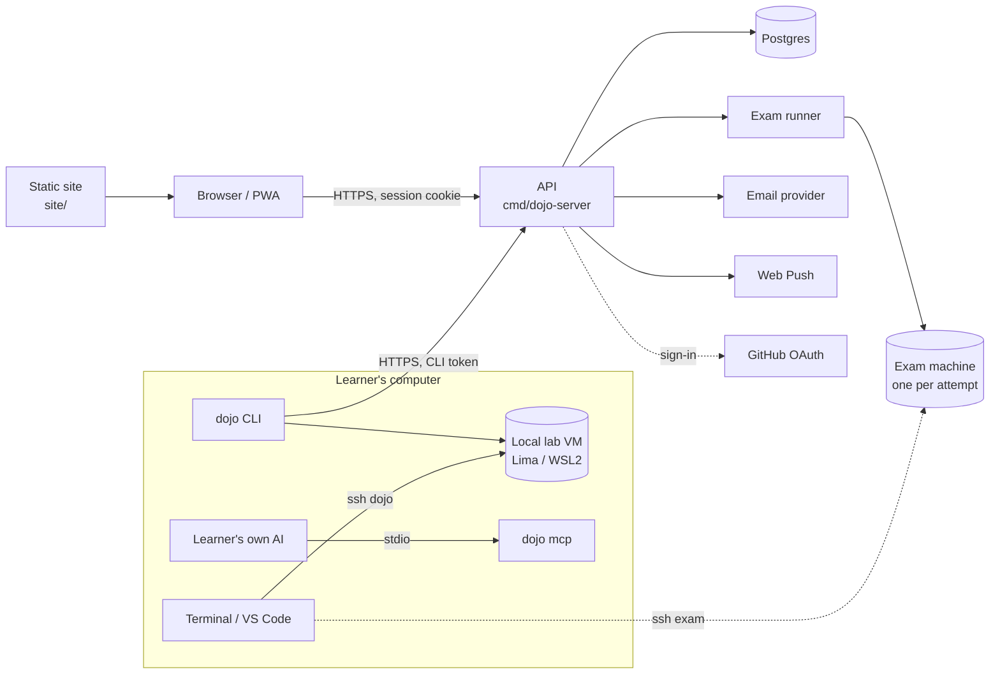
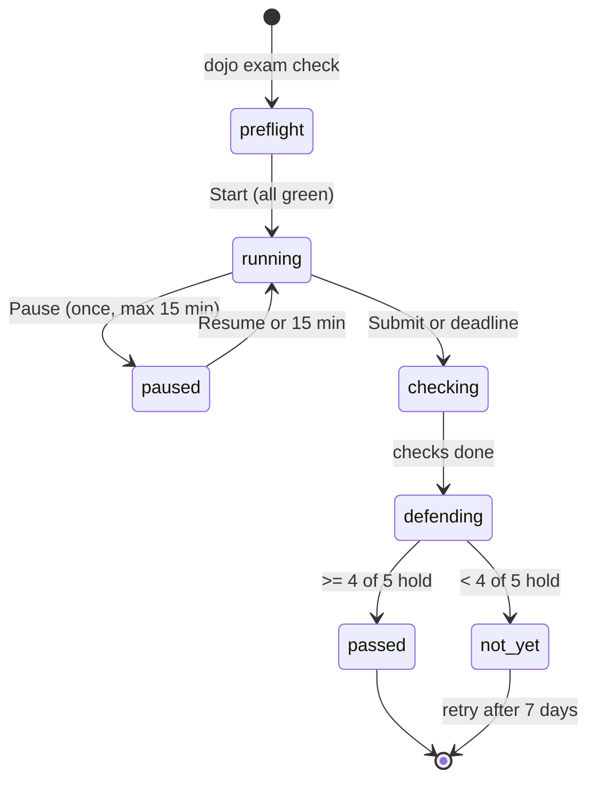

# Technical design: the Dojo web, v1

Status: draft for review. Scope: the white belt web described in the vision ("Web for v1") and
drawn on the design canvas. Everything parked on the canvas ("Later") stays out: public
portfolio, project review, community pages, belt share images, a chat mentor.

The CLI and the local labs already exist in this repo (`cmd/dojo`, `internal/lab`). This document
covers what v1 adds around them: the web, an API, a database, sign-in, the `dojo mcp` server and
the belt exam that runs on our machines.

## 1. Shape

Four pieces, one repo:

| Piece | Where | What it does |
|---|---|---|
| Site | `site/` | Public pages, onboarding, the learner app, lessons. Static build plus interactive islands. |
| API | `cmd/dojo-server`, `internal/server/...` | Sign-in, progress, quizzes, inbox, notifications, exams. The only writer to the database. |
| CLI | `cmd/dojo` (exists) | Labs, checks, hints, `dojo login`, `dojo mcp`, `dojo exam`. Reports progress to the API. |
| Exam runner | `cmd/dojo-runner`, `internal/exam/...`, next to the exam backend | Starts, checks and destroys one exam machine per attempt; also runs the SSH gateway. The API drives it over mTLS. |

The web and the API stay in this monorepo while they release together. They move out only if
their stack or release rhythm calls for it (vision, Platform).

## 2. Stack, and why each piece

| Layer | Choice | Why this and not the alternative |
|---|---|---|
| Site | Astro (static output) + React islands, Tailwind 4, shadcn/ui primitives | Most pages are content or read views; Astro ships no JS by default. Islands for the interactive parts (path graph, quiz, exam progress, command palette, inbox). shadcn/ui is the kit the identity board was drawn on. Starlight for lessons when lessons arrive (not v1). |
| API | Go, `net/http` routing, `pgx` + `sqlc`, `goose` migrations | Same language as the CLI: the kata format (`internal/kata`) and lab code are shared, not re-implemented. `sqlc` keeps SQL visible and typed without an ORM. |
| Database | Postgres | Relational data with constraints (one active exam per learner, unique usernames). Nothing in v1 needs more. |
| Sign-in | GitHub OAuth App (web flow + device flow) | Every learner needs GitHub anyway (repo, SSH key, signing). No passwords to store. |
| Email | A transactional provider behind an adapter; Mailpit in compose | Only E1 (welcome, sent on the first sign-in) and E2 (belt earned, sent when the result is final) in v1. The adapter keeps the provider swappable. |
| Push | Web Push with VAPID keys, sent by the API | No third-party push service; the browser vendors' endpoints only. |
| Exam machines | One fresh VM per attempt, from an image, destroyed after (section 7; backend open) | Checks read the disk from outside the guest and egress is filtered outside it, which a hosted container-VM cannot give us. |

Engineering bars that apply from the first commit:

- **Supply chain (site):** pnpm, exact versions, `save-exact=true`, committed lockfile,
  `--frozen-lockfile` in CI, `pnpm audit` and OSV failing on high or critical, install scripts off,
  every dependency justified in its PR, an SBOM per release.
- **Layers (API):** handlers stay thin; logic in `internal/server/service/<domain>`; database access
  in `internal/server/repo`; external systems (GitHub, email, push, exam backend, AI) behind adapters
  with one interface each.
- **Tenant column from day one:** every learner-owned row carries `org_id`. In v1 there is one org,
  "public". Schools (teacher dashboard) later become orgs without a migration of every table.
- **Tests:** `test` is unit; `test:integration` runs against the real stack in docker compose
  (Postgres, Mailpit, a fake GitHub OAuth server, the exam runner with a local backend). No mocks of
  services we own a real stand-in for.

## 3. Screens to routes

The canvas Map is the source of truth for screens. Every Map card maps to a route or a state of one.

| Map | Route | Rendering | Notes |
|---|---|---|---|
| P1 Landing | `/` | static | Copyable install command; no sign-in needed. |
| P2 How it works | `/how-it-works` | static | |
| P3 Belts | `/belts` | static | |
| P4 Requirements | `/requirements` | static | Same numbers as `dojo doctor`. |
| O1-O5 Onboarding | `/start/1` ... `/start/5` | island | Mirrors the terminal: each step turns green from CLI events (section 5). O3 blocked state: online labs are not built in v1, so the offer is a "tell me when" sign-up (`learners.lab_waitlist`) plus a link to the requirements. |
| L1 Today | `/today` | island | First-run variant after O5. |
| L2 Path | `/katas` | island | The git graph; data from `GET /v1/path`. |
| L3 Kata | `/katas/:belt/:name` | island | Ticket, fixed-means, hints, "mirrored from your laptop" panel. States: lab starting, failed, expired, passed, revisit. "Report a broken kata" and O3's "I'm stuck: get help" open a prefilled GitHub issue form on `kibanbuild/dojo` (kata id, CLI version, last check); no endpoint of ours in v1. |
| L4 Story | `/story` | island | |
| L6 Exam | `/exam/:belt` | island | Preflight, run, pause, defend, not-yet. Own header, no app nav. |
| L7/L8 Celebrations | `/stripe/:n`, `/belt/:belt` | island | Shown once, then reachable from the inbox. |
| L9 Writing kata | `/katas/:belt/:name` (kind `writing`) | island | Draft plus rubric review. |
| L11 Quiz | `/quiz/:id` | island | Never blocks progress. |
| N1 Inbox | dropdown / `/inbox` on phone | island | |
| K1 Command palette | everywhere in the app, desktop | island | |
| S1-S4 Settings | `/settings/{account,notifications,phone,ai}` | island | S1 holds username, language, extra time, danger zone. |
| W1-W4 Phone app | manifest, service worker | static | Install sheet, notification ask, offline page. |
| X1-X3 System | `/404`, `/500`, `/maintenance` | static | 500 shows the request id. |
| LG1 Legal | `/privacy` (tabs Terms, Code of conduct) | static | States what we keep after an account is deleted (section 6). |
| E1, E2 | email templates in the API | server | Light only. |

The app pages are static shells that fetch from the API with the session cookie. A signed-out
visit to an app route redirects to sign-in and back. The site never holds secrets.

**Offline (W4):** the service worker caches the app shell, the current kata's ticket and its
opened hints. Writes made offline are not queued: the page says it is offline and the CLI keeps
working against the local lab.

## 4. Sign-in and tokens

- **Web:** OAuth authorization-code flow run by the API (`/v1/auth/github/start`,
  `/v1/auth/github/callback`), with PKCE and a `state` bound to the browser by a short-lived cookie.
  Scopes: `read:user user:email` (the email is needed for E1 and E2; `/user/emails` requires
  `user:email`). On callback the API upserts the learner by numeric `github_id` and sets a session
  cookie: random 256-bit id, stored hashed, `HttpOnly`, `Secure`, `SameSite=Lax`, 30-day sliding
  expiry.
- **CLI:** `dojo login` uses the GitHub device flow (like `gh`) with our OAuth app's client id. The
  CLI sends the resulting GitHub token to `POST /v1/auth/cli` once. The API accepts it only if
  GitHub's check-token endpoint (`POST /applications/{client_id}/token`, authenticated with our
  client secret) confirms it was issued to **our** app; a personal token or one from another app is
  refused, so a leaked token cannot mint a Dojo login. The device flow asks for the same scopes
  as the web, since a learner may sign in from the CLI first. The API reads the profile (id, login,
  email), revokes that one token (`DELETE /applications/{client_id}/token`, never `.../grant`,
  which would sign out every device), and only then returns its own CLI token. The revoke is part
  of the request: if it fails, the login fails and the learner tries again, so no GitHub token is
  ever stored, not even to retry (OAuth app tokens do not expire on their own). The web flow's
  token is revoked the same way inside the callback. CLI tokens are random,
  stored hashed, listed and revocable in S1. The CLI stores its token in the OS keychain where
  there is one, else in `DOJO_HOME` with `0600`.
- **We hold no token to the learner's GitHub account.** Their public repo is read without auth,
  which keeps the attack surface small (vision, Progress).
- **Same site:** the session cookie is `SameSite=Lax`, so the site and the API must share one
  registrable domain (for example the site on the apex and the API on `api.`). This is a constraint
  on the domain choice (section 11).
- **CSRF:** every state-changing request needs a JSON body and a custom header, and the API allows
  CORS with credentials only from the site's own origin.
- **Input from the CLI is untrusted text:** event payloads are size-limited (64 KB per event, 1 MB
  per batch, check output cut at 16 KB) and always rendered escaped.
- **Username:** `@name` chosen in S1, unique, lowercased, 3-30 chars `[a-z0-9-]`, reserved list
  (admin, api, dojo, kiban, ...). Defaults to the GitHub login when free.

## 5. Progress: who is trusted with what

The local check runs on the learner's machine, so a kata pass is **self-reported**. That is fine:
katas are practice, not a credential. Only the belt exam is authoritative, and it runs on our
machines (section 7). The design follows from that:

| Event | Source | Trusted for |
|---|---|---|
| Onboarding steps (O1-O5) | CLI: `doctor` results, `login`, SSH key found, commit signing configured, repo and AGENTS.md written, first `start` | Showing progress only |
| Kata started, check run (pass/fail + output), hint opened | CLI | Today, path, stripes |
| Quiz answer | Web | Quizzes |
| Writing kata draft and review | Web + our AI | Feedback only, never pass/fail by AI |
| Exam result | Exam runner | Belts |

- The CLI sends events to `POST /v1/events` (batched, idempotent by a client-generated id) after
  each command. Offline, it queues them in `DOJO_HOME` and sends them on the next command. The local
  state file stays the CLI's own record; the API is the web's.
- A **stripe** is awarded by the API when the learner has passed the katas of that stripe's group.
  The **belt** is awarded only by an exam pass.
- "Mirrored from your laptop" on L3 means the API shows the last `dojo check` output and the lab
  state the CLI reported. It is not a live terminal stream; that stays out of v1.
- **Hints** live in the catalog (`kata.yaml`). The web shows a hint only after the learner opens it
  (from the web or `dojo hint`, which report the same event), so both stay in step. Hint 3 unlocks
  after hint 2 and a check run, as drawn. The gating is a nudge, not a lock: hints ship in the
  CLI binary with the kata, and that is fine for practice.

## 6. Data model (v1)

Every table below also has `org_id`, `created_at`, `updated_at`. Ids are UUIDv7.

| Table | Key columns | Notes |
|---|---|---|
| `learners` | `github_id` (unique), `github_login`, `username` (unique), `email`, `language`, `extra_time` (bool), `deleted_at` | `extra_time` set in S1 applies to every exam. |
| `sessions`, `cli_tokens` | `learner_id`, `token_hash`, `last_used_at`, `revoked_at` | Hashes only. |
| `catalog_items` | `kata_id`, `belt`, `kind` (kata, quiz, writing), `position`, `stripe`, `catalog_version` | Loaded from the catalog at deploy; the API never parses YAML at request time. |
| `kata_progress` | `learner_id`, `kata_id`, `state` (started, passed), `hints_opened`, `checks`, `first_passed_at`, `last_check_output` | One row per learner and kata; revisits do not change `first_passed_at`. |
| `events` | `learner_id`, `client_id` (unique per learner), `type`, `payload` (jsonb), `at` | Append-only, the audit trail behind `kata_progress`. |
| `quiz_answers` | `learner_id`, `quiz_id`, `question`, `choice`, `correct` | |
| `awards` | `learner_id`, `kind` (stripe, belt), `belt`, `n`, `exam_id`, `exam_result` | Belt rows: `exam_result` is checked to equal `passed` and `(exam_id, learner_id, belt, exam_result)` is a foreign key to `exams(id, learner_id, belt, result)` (unique there), so a belt row needs a passed exam by the same learner for the same belt. A foreign key skips rows with a null column, so two checks close the gap: `(kind = 'belt') = (exam_id IS NOT NULL AND exam_result IS NOT NULL)` and `kind <> 'belt' OR exam_result = 'passed'`, plus `kind <> 'belt' OR belt IS NOT NULL`. Stripe rows leave both null. |
| `exams` | `learner_id`, `belt`, `state`, `started_at`, `deadline`, `paused_at`, `pause_used`, `time_factor`, `machine_ref`, `result`, `retry_after` | Partial unique index: one exam not in a final state per learner. A trigger refuses any change to `result` once it is final. |
| `exam_tickets` | `exam_id`, `ticket`, `params`, `check_passed`, `check_output`, `learner_summary` | Five per white belt exam. `check_output` is for us; the learner only sees `learner_summary`, a line written with the ticket ("the service still runs as root"). |
| `exam_defence` | `exam_id`, `question`, `answer`, `review` | Three questions. |
| `writing_drafts` | `learner_id`, `kata_id`, `body`, `submitted_at`, `review` (jsonb: rubric scores and comments) | L9. Feedback only; a writing kata passes when the learner submits it. |
| `inbox_items` | `learner_id`, `kind`, `ref`, `read_at` | Feeds N1 and the bell. |
| `push_subscriptions`, `notification_prefs` | endpoint, keys; per-kind toggles, quiet hours | Story max 1 a day, quiet 22:00-08:00 local. |
| `teardown_jobs` | `backend`, `resources` (list of the backend's ids: machines, volumes, snapshots), `attempts`, `done_at` | No learner id: only what the runner must destroy. Also used at the normal end of an exam. |
| `exam_tombstones` | `github_id`, `belt`, `retry_after` | The only thing kept after a delete, so deleting an account does not skip the retry wait. It keeps the GitHub numeric id (an identifier, said so on LG1) until `retry_after`, then is deleted. No name, email or results. |

**Delete account (S1 danger zone):** in one transaction, ends any exam not yet final as `not_yet`
with its `retry_after`, writes the tombstone if a retry wait is running, deletes every other learner
row and revokes every token. In the same transaction it writes a `teardown_jobs` row listing every
resource the attempt used (machines, volumes, snapshots), which the runner works through and retries until everything is destroyed,
whatever state the exam was in, so a crash after the commit cannot orphan a machine. Backups keep data for 30 days. The
privacy page (LG1) says all of this.

## 7. Belt exam

The exam is where the Dojo is strict about what it can actually guarantee: the learner cannot
read or change the checks, cannot extend the clock and cannot reach the internet from the exam
machine. It **cannot** stop a learner from asking an AI on their own computer: there is no
proctoring. That is acceptable because a Dojo belt is a step on our own path, not a third-party
credential, and the defend step (below) asks the learner to explain their own changes. Values from
the canvas: 5 tickets, 2 hours, one pause of up to 15 minutes, pass at 4 of 5, retry after 7 days,
extra time 1.5x.

- **Clock on the server.** `deadline = started_at + 2h × time_factor`, and on resume the deadline
  moves by the time actually paused. The page and CLI only display it. Deadlines live in the `exams`
  table and a sweeper in the API acts on them every 15 seconds (it resumes any pause past 15
  minutes, and never ends a paused exam), so a restart loses nothing and a pause started just before
  the deadline does not end the exam. At the deadline the runner cuts access and submits whatever is
  there. Milestone announcements (30, 10, 1 minutes left) are live-region messages, not a ticking
  announcement every second.
- **Pause** kills the open SSH sessions and forwards, refuses new ones and stops the clock. Where
  the backend can freeze a VM it does, so no background job keeps working; where it cannot, a job
  left running during a pause is accepted for the white belt (checks look at the final state, not
  at when it was reached). After 15 minutes the clock restarts whether or not the learner is back.
- **Access:** the learner reaches the machine through an exam gateway we run (an SSH jump host).
  `dojo exam start` sends the learner's public key with their CLI token, and the gateway accepts
  that key for that learner's open exam only. No lookup by GitHub username, so a renamed or reused
  login cannot be authorised by mistake. The CLI writes an `ssh exam` host entry, like `ssh dojo`.
- **Who can start:** the API refuses `/exam/:belt` and `dojo exam start` unless the learner holds
  the 4 stripes of that belt, has no open attempt, and both their latest `retry_after` and any
  tombstone for their `github_id` are in the past. The rules page (L6) shows which one is missing.
- **Preflight (`dojo exam check`):** connects to the gateway with the learner's key (this proves the
  key works and that their network allows outbound SSH, which school networks sometimes block) and
  confirms no other attempt is open. Start stays disabled until it is green.
- **Tickets vary per attempt.** Each ticket in the private pool (`kibanbuild/dojo-katas`) has
  parameters (which file, which user, which port); the runner draws five tickets and their
  parameters per attempt. A learner who memorises one attempt does not hold the next one.
- **Checks run from outside the guest.** The learner is root on the exam machine for two hours and
  could replace any binary or leave a process waiting for the check, so nothing trusted runs inside
  it. On submit or at the deadline, the runner cuts access, asks the guest to `sync` (the learner
  can refuse, which only hurts their own result), stops the machine gracefully and forces it off
  after 30 seconds. A trusted checker with its own tools then mounts the machine's disk read-only
  and runs the checks against that tree. An unclean ext4 journal is replayed only on a scratch
  copy (a second volume or a copy in memory), never on the original, which stays untouched as
  evidence until the result is final. How the disk reaches the checker depends on the backend
  (section 7, "Where exam machines run").
  The learner controls every byte of that disk, so the checker treats it as hostile input:
    - reads never follow symlinks out of the mount (`openat2` with `RESOLVE_IN_ROOT`, or no-follow
      lookups), and file content is only data, never executed, sourced or chrooted into;
    - the checker has no network and no secrets and is used for one exam only: a crafted
      filesystem attacks the checker's kernel, which is why it is disposable and never our API or
      runner host. With a rescue system the checker is the exam server itself, rebooted into a
      kernel and tools the provider controls; it is still one-use and destroyed after the exam.
  White belt checks are about file state (permissions, owners, configs), which a mounted tree
  answers. Checks on a running system (is the service up, does the port answer) need the snapshot
  booted again, and the learner's own init would run; how to trust that is designed before the
  yellow belt (section 11).
  The checks never enter the learner's machine, and the learner sees only `learner_summary` per
  ticket, never check output.
- **Defend (L6Defend):** after checks, our AI writes three "why" questions from what the learner
  changed (a diff of the snapshot against the broken baseline, read as text, never run). The learner
  answers in the web within 30 minutes. The review can ask for more but **does not decide the
  belt**: pass or fail is the checks, as the vision says. A timeout records the defence as
  unanswered; the belt still follows the checks. Whether a blank defence should block the belt is
  an open question (section 11).
- **When the result is final:** at the end of defend, or of its 30-minute timeout. That moment sets
  `result` and `retry_after`, writes the belt award on a pass and sends E2.
- **Wiped at the end:** the exam machine and any separate checker are destroyed after checks; every
  disk and volume the attempt used when the result is final, or at once if the account is deleted. Results, tickets and the diff are
  kept; nothing else.
- **Egress is filtered outside the guest,** where a root learner cannot remove it (a provider
  firewall, security group or host rule, depending on the backend): the machine only reaches the
  gateway and the allowlist a ticket names (resolved to IP addresses: provider firewalls and
  security groups filter by address, not by name), and exam machines cannot reach each other, any
  of our services or the provider's metadata endpoint (169.254.169.254), so no credential can be
  read from inside. A separate checker gets a firewall or security group with no network at all. CPU and memory are fixed by the machine size; one open attempt per learner.

### Where exam machines run

The runner talks to an `ExamBackend` interface (`Create`, `Exec`, `Stop`, `CheckDisk`, `Destroy`,
plus `Freeze` and `Thaw` where supported), the same idea as the local `lab.Backend`. Any backend
must give three things: a fresh full VM from an image (systemd included, for the yellow belt), a way
to read its disk from a trusted checker, and egress filtering outside the guest. Hosted
container-VMs (Fly Machines, for example) fail the second and third: the root filesystem is
ephemeral and there is no per-machine egress policy.

| Candidate | Image | How the checker reads the disk | Egress outside the guest |
|---|---|---|---|
| Ephemeral cloud servers (for example Hetzner Cloud) | A snapshot built with Packer | Reboot the stopped server into the provider's rescue system and mount its disk there | The provider's cloud firewall |
| Ephemeral EC2 instances on AWS | An AMI built with Packer | Detach the stopped instance's root volume and attach it to a checker instance | Security groups |
| Firecracker microVMs on a KVM host we run | A rootfs image | Copy the disk and attach it read-only to a checker microVM | Host rules on each tap device |

The choice follows the shared Kiban platform decision, still open (section 11). The first two are
billed per hour and cost cents per exam, with no host to patch; the third starts in under a second
and can freeze a VM, but is a dedicated server to run. Whichever wins, the local backend in compose
runs the same runner code with QEMU for unit and integration tests, and an end-to-end exam run on
the real backend (escape attempts included: a planted symlink, a removed firewall rule, a job left
running in pause) is a gate before `pre`.

## 8. `dojo mcp` and AGENTS.md

`dojo mcp` is an MCP server over stdio, started by the learner's AI tool. It is read-only and
local:

| Tool | Returns |
|---|---|
| `current_kata` | Ticket, fixed-means, belt |
| `last_check` | Output of the last `dojo check` |
| `hints_opened` | Hints the learner already opened (never the unopened ones) |
| `docs` | The man pages and lesson links the kata names |

The server's `instructions` and the `AGENTS.md` the CLI writes into the learner's repo and lab
(plus a `CLAUDE.md` with `@AGENTS.md`, `.github/copilot-instructions.md` and a Cursor rule) say the
same thing: ask what they tried, explain, point to the docs, never write the fix. No written
solution ships to the learner's machine. The kata's `setup.sh` and `check.sh` do (the CLI needs them
to break and verify the lab), so a determined learner can read how the check works. That is fine
for practice; it is why belts come only from the exam. `dojo mcp` does not run while the learner
has an exam open, which is a courtesy, not a control.

## 9. Environments, delivery, operations

| Environment | What | How |
|---|---|---|
| local | Everything in docker compose: API, Postgres, Mailpit, fake OAuth, runner with a local backend; site dev server | `make dev` |
| `pre` | Site, API and database of its own; real GitHub OAuth app; email in sandbox; exams on the exam backend | Deploy on merge to `main` |
| `pro` | Site, API and database of its own; exams on the exam backend | Deploy on a release tag |

`pre` and `pro` use the same exam backend in v1, with separate runner credentials and separate
exam networks.

- Site: static build to a CDN. API: one container image on GHCR, one small instance, behind TLS.
  Postgres managed, daily backups, 30-day retention.
- Workflows follow the repo rules (`Web: Tests`, `Web: Build`, `API: Tests`, required checks never
  path-filtered).
- Logs as JSON with a request id that the 500 page (X2) shows. Metrics: request rate and errors,
  exam machines running, exam start latency, events ingested.
- Maintenance (X3): a flag the API serves; the site shows X3 and the CLI keeps working on local
  labs.

## 10. Accessibility carried into the build

From the accessibility review of the canvas, things a mockup cannot show:

- Dialogs (palette, install sheet, danger zone) trap focus, restore it on close, close on Escape.
- Tabs (phone tab bar, settings tabs, MCP config tabs) use roving tabindex and arrow keys.
- The command palette is a combobox with `aria-activedescendant`.
- Live regions for check results, quiz feedback and exam milestones; polite unless the exam is
  about to end.
- `prefers-reduced-motion` turns off celebration motion and carousel animation.
- Viewport allows zoom; 44 px touch targets on phone; `lang` set per page (English UI, Spanish
  where the learner chose it for context pages).
- Extra time (1.5x) is a setting the learner turns on themselves, no proof asked.

## 11. Open questions

Decided 2026-11-19: the defence is feedback only (the belt follows the checks); extra time is
self-declared in S1.

1. **Exam backend and hosting:** waits on the shared Kiban platform (one cloud, or a few, for
   every Kiban project). The three candidates are in section 7; the site, API and database follow
   the same decision.
2. **Running-system checks** for the yellow belt: how to check a booted snapshot without trusting
   the learner's init.
3. **Domain:** the canvas uses `[DOMAIN]`. The site and the API must share one registrable domain
   (section 4), and both need it before `pre`.
4. **Email provider** and **site CDN**: chosen in the PR that adds them, against the adapter.
5. **Kata variants per learner** for practice katas: out of v1 (the CLI binary embeds the catalog,
   as today). The API records `catalog_version` so they can come later without breaking progress.
   Exam tickets vary per attempt from v1 (section 7).

## 12. Build order

Small PRs, one open at a time, each with its tests and docs:

1. API skeleton: config, health, logging, migrations, compose stack, `API: Tests`.
2. Sign-in: GitHub web flow, sessions, `dojo login` device flow, CLI tokens.
3. Catalog sync and `GET /v1/path`; CLI events and `kata_progress`.
4. Site skeleton: Astro, tokens from the identity board, public pages P1-P4, `Web: Tests`.
5. Onboarding O1-O5 and Today L1 on real data.
6. Kata page L3 with hints and the mirrored check panel; path L2; quizzes L11.
7. `dojo mcp` and the AGENTS.md files.
8. Exam runner with the local QEMU backend in compose, then the real backend and the gateway;
   exam pages L6; awards L7/L8.
9. Inbox, emails E1/E2, Web Push, settings S1-S4.
10. PWA install, offline, system pages; then `pre`, then the first learners.
